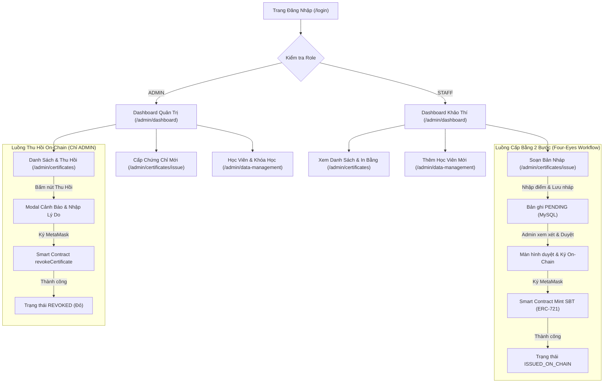

# ĐẶC TẢ GIAO DIỆN & LUỒNG THAO TÁC PHÂN HỆ QUẢN TRỊ (ADMIN UI & WORKFLOWS)
**Hệ Thống Quản Lý & Cấp Phát Chứng Chỉ Tiếng Anh Bằng Blockchain (CertChain)**

> **Phiên bản tài liệu**: 2.0 (Comprehensive UI/UX & Flow Specification)  
> **Cập nhật ngày**: 15/11/2026  
> **Mục đích**: Tài liệu hóa toàn bộ cấu trúc giao diện, thành phần đồ họa (UI Components), tương tác người dùng (User Interactions) và luồng nghiệp vụ trên phân hệ Quản trị CertChain (`/admin/*`).

---

## 📑 MỤC LỤC TỔNG QUAN

1. [Tổng Quan Kiến Trúc Giao Diện (Admin UI Architecture)](#1-tổng-quan-kiến-trúc-giao-diện-admin-ui-architecture)
2. [Hành Trình Người Dùng & Sơ Đồ Điều Hướng (User Journey & Navigation Flow)](#2-hành-trình-người-dùng--sơ-đồ-điều-hướng-user-journey--navigation-flow)
3. [Chi Tiết Từng Màn Hình & Thành Phần Giao Diện](#3-chi-tiết-từng-màn-hình--thành-phần-giao-diện)
   - [Màn hình 1: Trang Đăng Nhập Quản Trị (`/login`)](#màn-hình-1-trang-đăng-nhập-quản-trị-login)
   - [Màn hình 2: Bảng Điều Khiển Tổng Quan (`/admin/dashboard`)](#màn-hình-2-bảng-điều-khiển-tổng-quan-admindashboard)
   - [Màn hình 3: Màn Hình Soạn Thảo & Cấp Bằng On-Chain (`/admin/certificates/issue`)](#màn-hình-3-màn-hình-soạn-thảo--cấp-bằng-on-chain-admincertificatesissue)
   - [Màn hình 4: Quản Lý Danh Sách & Thu Hồi Chứng Chỉ (`/admin/certificates`)](#màn-hình-4-quản-lý-danh-sách--thu-hồi-chứng-chỉ-admincertificates)
   - [Màn hình 5: Quản Trị Dữ Liệu Học Viên & Khóa Học (`/admin/data-management`)](#màn-hình-5-quản-trị-dữ-liệu-học-viên--khóa-học-admindata-management)
4. [Danh Mục Các Thành Phần Giao Diện Dùng Chung (Shared UI Components)](#4-danh-mục-các-thành-phần-giao-diện-dùng-chung-shared-ui-components)
5. [Ma Trận Hiển Thị Giao Diện Theo Vai Trò (UI Visibility by Role)](#5-ma-trận-hiển-thị-giao-diện-theo-vai-trò-ui-visibility-by-role)

---

## 1. TỔNG QUAN KIẾN TRÚC GIAO DIỆN (ADMIN UI ARCHITECTURE)

Phân hệ Quản trị CertChain được xây dựng theo kiến trúc **Khung làm việc một cột kết hợp thanh điều hướng cố định (Sticky Sidebar Layout)**, tối ưu cho các thao tác quản trị dữ liệu mật độ cao và tích hợp Web3 thời gian thực:

```
+---------------------------------------------------------------------------------------------------------+
|                                    CẤU TRÚC LAYOUT TỔNG THỂ (AdminLayout)                               |
+------------------------------------+--------------------------------------------------------------------+
|  SIDEBAR CỐ ĐỊNH (280px)           |  TOPBAR HEADER (Sticky 64px)                                       |
|  - Brand Header (Logo & Tên app)   |  - Breadcrumbs điều hướng ("Hệ Thống > Bảng Điều Khiển")           |
|  - Role Card (User Name & Role)    |  - ThemeToggle (Nút Dark/Light Mode)                               |
|  - Module Nghiệp Vụ (4 Menu items) |  - Nút Ví MetaMask (Chỉ Admin) / Nhãn Staff                        |
|  - Liên Kết Ngoài (Verify, QR)     |  - Nút Đăng Xuất (Logout)                                          |
|  - System Health (Contract, IPFS)  +--------------------------------------------------------------------+
|                                    |  MAIN WORKSPACE (Scrollable Content Body)                          |
|                                    |  - Hiển thị động theo từng Route:                                  |
|                                    |    + /admin/dashboard (Thống kê & Cảnh báo)                        |
|                                    |    + /admin/certificates (Bảng dữ liệu & Thu hồi)                 |
|                                    |    + /admin/certificates/issue (Form nhập & Live Preview)         |
|                                    |    + /admin/data-management (Quản lý Học viên & Khóa học)          |
+------------------------------------+--------------------------------------------------------------------+
```

### Hệ thống Design System & Quy chuẩn màu sắc (Theme Tokens)
* **Giao diện Kép (Dual Theme)**: Chuyển đổi linh hoạt giữa Dark Mode (mặc định cho phong cách Web3 công nghệ cao) và Light Mode (chuẩn văn phòng đào tạo).
* **Màu chủ đạo (Primary)**: `#38bdf8` (Cyan Neon / Sky Blue) biểu trưng cho tính minh bạch và công nghệ Blockchain.
* **Màu thành công (Success)**: `#10b981` (Emerald Green) biểu trưng cho chứng chỉ hợp lệ On-chain.
* **Màu cảnh báo (Warning)**: `#f59e0b` (Amber Gold) dùng cho trạng thái chờ duyệt `PENDING` và nhãn `STAFF`.
* **Màu báo động (Danger)**: `#ef4444` (Crimson Red) dùng cho chứng chỉ bị thu hồi `REVOKED` và nút thao tác nguy hiểm.
* **Hiệu ứng kính mờ (Glassmorphism)**: `backdrop-filter: blur(16px)`, nền thẻ bán trong suốt kết hợp viền mảnh `1px solid rgba(255, 255, 255, 0.08)`.

---

## 2. HÀNH TRÌNH NGƯỜI DÙNG & SƠ ĐỒ ĐIỀU HƯỚNG (USER JOURNEY & NAVIGATION FLOW)



---

## 3. CHI TIẾT TỪNG MÀN HÌNH & THÀNH PHẦN GIAO DIỆN

---

### MÀN HÌNH 1: TRANG ĐĂNG NHẬP QUẢN TRỊ (`/login`)

#### 1. Bố cục & Thành phần giao diện (UI Components)
* **Khung đăng nhập trung tâm (Center Auth Card)**:
  * **Brand Header**: Icon khiên bảo vệ `ShieldCheck` phát sáng neon, tiêu đề **CERTCHAIN** kèm khẩu hiệu *"Cổng Quản Trị Trung Tâm Tiếng Anh"*.
  * **Trường Tên đăng nhập**: Input text có icon `@`, placeholder `VD: admin_khoa hoặc staff_long`.
  * **Trường Mật khẩu**: Input password có icon chìa khóa `Lock` và nút con mắt bật/tắt hiển thị mật khẩu.
  * **Nút bấm chính (Submit Button)**: Nút màu xanh `btn-primary` toàn chiều rộng: *"Đăng Nhập Quản Trị"*.
  * **Khu vực Demo Quick-Fill**: 3 nút bấm điền tự động hỗ trợ hội đồng nghiệm thu kiểm thử nhanh:
    1. `👑 Admin (Giám Đốc)`: Tự điền `admin_khoa` / `123456`.
    2. `💼 Staff (Khảo Thí)`: Tự điền `staff_long` / `123456`.
    3. `🎓 Học Viên (Tra Cứu)`: Tự điền `student_yen` / `123456`.
  * **Thông báo lỗi (Error Alert)**: Banner màu đỏ hiển thị khi sai thông tin hoặc tài khoản bị khóa.

#### 2. Luồng thao tác (User Interactions)
1. Người dùng truy cập route `/login`.
2. Click nút Quick-Fill hoặc tự gõ tài khoản $\to$ Bấm **"Đăng Nhập Quản Trị"**.
3. Frontend gọi `POST /api/auth/login`. Nhận về JWT Token và thông tin User.
4. Lưu session vào `localStorage` $\to$ Chuyển hướng tức thì sang `/admin/dashboard`.

---

### MÀN HÌNH 2: BẢNG ĐIỀU KHIỂN TỔNG QUAN (`/admin/dashboard`)

#### 1. Bố cục & Thành phần giao diện (UI Components)

```
+---------------------------------------------------------------------------------------------------+
| [TIÊU ĐỀ CHÀO MỪNG] Bảng Điều Khiển Quản Trị              [NÚT TẮC VỤ: Cấp Bằng | Danh Sách | Data] |
| Xin chào, Nguyễn Thị Minh Khoa • Thẩm quyền: [ADMIN]                                              |
+---------------------------------------------------------------------------------------------------+
| [BANNER TRẠNG THÁI WEB3]                                                                          |
| Ví Admin: 0xf39F...2266 (9,999 ETH) • Mạng: Hardhat Localhost (31337) • Hợp đồng: Kết nối tốt     |
+---------------------------------+---------------------------------+-------------------------------+
| THẺ 1: TỔNG CHỨNG CHỈ           | THẺ 2: ĐÃ CẤP ON-CHAIN          | THẺ 3: BẢN NHÁP CHỜ DUYỆT     |
| [Icon Award] 6 Văn bằng         | [Icon Check] 4 Token hợp lệ     | [Icon Clock] 1 Đang chờ duyệt |
+---------------------------------+---------------------------------+-------------------------------+
| KHU VỰC CÔNG VIỆC CẦN XỬ LÝ (ACTION ITEMS)                                                        |
| 🔔 Có 1 hồ sơ PENDING cần Ban Giám Hiệu đối soát và phê duyệt cấp bằng on-chain                    |
+--------------------------------------------------+------------------------------------------------+
| BIỂU ĐỒ PHÂN BỐ KỲ THI (Course Distribution)     | NHẬT KÝ KIỂM TOÁN GẦN ĐÂY (Recent Audit Logs)  |
| - IELTS Academic: 40%                            | [15:42] Admin đúc On-chain mã CERT-IELTS-001   |
| - TOEIC 4-Skills: 30%                            | [14:20] Staff Long tạo nháp mã CERT-TOEIC-088  |
| - VSTEP Bậc 5 (C1): 20%                          | [11:15] Admin thu hồi mã CERT-VSTEP-012        |
| - Cambridge CAE: 10%                             |                                                |
+--------------------------------------------------+------------------------------------------------+
```

* **Thẻ Thống Kê KPI (Counter Cards)**: 4 thẻ kính mờ hiển thị các chỉ số trọng yếu:
  * *Tổng số chứng chỉ*: Màu xanh dương, icon `Award`.
  * *Đã phát hành On-Chain*: Màu xanh ngọc lục bảo, icon `CheckCircle2`.
  * *Bản nháp chờ duyệt (`PENDING`)*: Màu vàng hổ phách, icon `Clock`.
  * *Đã thu hồi (`REVOKED`)*: Màu đỏ, icon `XCircle`.
* **Khu vực Công Việc Cần Xử Lý (Action Required)**:
  * Banner thông báo động nhắc nhở Admin khi có hồ sơ `PENDING` hoặc giao dịch cần đối soát.
* **Bảng Phát Hành Gần Đây (Recent Certificates Table)**:
  * 5 dòng chứng chỉ mới nhất hiển thị: Mã bằng, Tên học viên, Khóa học, Điểm Overall, Ngày cấp và Nhãn trạng thái màu sắc (`StatusTag`).

---

### MÀN HÌNH 3: MÀN HÌNH SOẠN THẢO & CẤP BẰNG ON-CHAIN (`/admin/certificates/issue`)

Đây là **màn hình nghiệp vụ cốt lõi nhất** của hệ thống, được thiết kế theo cấu trúc **2 cột song song (Split Screen Layout)**:
* **Cột trái (50%)**: Form nhập liệu nghiệp vụ & Động cơ kiểm tra.
* **Cột phải (50%)**: Khung xem trước trực quan thời gian thực (Live Preview phôi bằng).

```
+------------------------------------------------------+------------------------------------------------------+
|  CỘT TRÁI: FORM NHẬP LIỆU NGHIỆP VỤ                  |  CỘT PHẢI: LIVE PREVIEW PHÔI BẰNG THỜI GIAN THỰC     |
+------------------------------------------------------+------------------------------------------------------+
|  [MÃ BẰNG]: CERT-IELTS-2026-950 (Tự động sinh)       |  ┌────────────────────────────────────────────────┐  |
|                                                      |  │     INTERNATIONAL ENGLISH TESTING CENTER       │  |
|  [CHỌN HỌC VIÊN]: Dropdown học viên có sẵn           |  │                                                │  |
|  Họ tên: Phạm Quốc Hưng   | Mã HV: HV2026-0199       |  │           CERTIFICATE OF PROFICIENCY           │  |
|                                                      |  │                                                │  |
|  [CHỌN KỲ THI]: IELTS Academic Master                |  │             PHẠM QUỐC HƯNG                     │  |
|                                                      |  │             Mã học viên: HV2026-0199           │  |
|  [ĐIỂM SỐ OVERALL]: 🔒 [7.5 Overall] (Khóa sửa tay)  |  │                                                │  |
|                                                      |  │  OVERALL   Listening  Reading  Writing Speaking│  |
|  [ĐIỂM 4 KỸ NĂNG] (🔒 Niêm phong Four-Eyes cho Admin)|  │    7.5        8.0      7.5      7.0     7.5  │  |
|  [L: 8.0]   [R: 7.5]   [W: 7.0]   [S: 7.5]           |  │                                                │  |
|                                                      |  │  TRẠNG THÁI: HỢP LỆ ON-CHAIN    [MÃ QR XÁC THỰC]│  |
|  [NGÀY CẤP]: 15/11/2026  | [HẠN DÙNG]: 15/11/2028    |  │  Token ID: #1001 • CID Pinata   (Nhúng URL)    │  |
|                                                      |  └────────────────────────────────────────────────┘  |
|  [ĐỊA CHỈ VÍ METAMASK HỌC VIÊN] (EIP-55 Checksum)    |                                                      |
|  0x9965507d1a55bcc2695c58ba16Fb37D819b0A4dF         |  [BẰNG CHỨNG BLOCKCHAIN DỰ THẢO]                     |
|                                                      |  - Smart Contract: 0x5FbDB...0aa3                    |
|  NÚT HÀNH ĐỘNG PHÂN QUYỀN:                           |  - Chuẩn Token: Soulbound ERC-721 (Non-transferable) |
|  - ADMIN: [Ký MetaMask & Cấp Bằng On-Chain (Cam)]   |                                                      |
|  - STAFF: [Lưu Bản Nháp Chờ Admin Duyệt (Vàng)]      |                                                      |
+------------------------------------------------------+------------------------------------------------------+
```

#### Các thành phần giao diện đặc thù:
1. **Ô Điểm số Overall bị khóa cứng (`readOnly`)**:
   * Có biểu tượng ổ khóa `🔒` và badge: `Tự động tính toán (Không thể sửa tay)`.
   * Giá trị được tính tự động từ 4 kỹ năng bởi [scoreEngine.js](file:///D:/blockchain/blockchain-english-certificates/frontend/src/services/scoreEngine.js) theo công thức làm tròn chuẩn của IDP/British Council/ETS.
2. **Khung Niêm Phong Điểm Số Theo Nguyên Tắc Bốn Mắt (Four-Eyes Locking)**:
   * Khi đăng nhập bằng `ADMIN`: 4 ô điểm kỹ năng bị khóa xám (`readOnly`, con trỏ `not-allowed`) kèm banner thông báo:
     > 🔒 **Nguyên tắc Bốn Mắt (Four-Eyes):** Dữ liệu điểm do Cán bộ Khảo thí nhập liệu đã được niêm phong. Admin có quyền đối soát và ký phát hành on-chain, không được tùy tiện sửa điểm.
   * Cung cấp checkbox mở khóa khẩn cấp nếu Admin có biên bản hội đồng kỷ luật điều chỉnh.
3. **Phôi Bằng Sống (Interactive Certificate Preview)**:
   * Thể hiện trung thực diện mạo chứng chỉ vật lý: Hoa văn viền hoàng gia cổ điển, tem nổi chống giả màu vàng kim, con dấu nổi trung tâm, bảng điểm 4 kỹ năng và **Mã QR động**.
4. **Modal Thành Công Rực Rỡ (Success Modal with Confetti)**:
   * Khi giao dịch on-chain được thợ đào đóng block, màn hình bắn pháo hoa ăn mừng (`canvas-confetti`).
   * Hiển thị bảng tóm tắt bằng chứng: Token ID, Transaction Hash (rút gọn kèm link mở Etherscan), IPFS CID và 2 nút tải phôi bằng PDF / xem trang tra cứu công khai.

---

### MÀN HÌNH 4: QUẢN LÝ DANH SÁCH & THU HỒI CHỨNG CHỈ (`/admin/certificates`)

#### 1. Bố cục & Thành phần giao diện (UI Components)
* **Thanh công cụ Tìm kiếm & Bộ lọc Đa Chiều (Search & Filter Bar)**:
  * Ô tìm kiếm từ khóa với icon `Search` (Tìm theo Mã chứng chỉ, Tên học viên, Mã số học viên).
  * Bộ lọc Khóa học (Dropdown): Tất cả khóa học, IELTS Academic, TOEIC 4-Skills, VSTEP B2-C1, Cambridge CAE.
  * Bộ lọc Trạng thái: Tất cả trạng thái, Đã cấp On-Chain (`ISSUED_ON_CHAIN`), Chờ duyệt (`PENDING`), Bị thu hồi (`REVOKED`).
* **Bảng Dữ Liệu Chứng Chỉ (Data Table)**:
  * Các cột: Mã Chứng Chỉ, Học Viên, Khóa Học, Điểm Overall, Ngày Cấp, Trạng Thái, Thao Tác.
  * Phân trang: Điều khiển chuyển trang trước/sau và hiển thị tổng số kết quả.
* **Cột Thao Tác (Action Buttons)**:
  * 👁️ **Nút Xem PDF**: Mở Modal xem trước tệp PDF vector.
  * 🔗 **Nút Explorer**: Mở liên kết tra cứu TxHash trên mạng chuỗi khối.
  * 🔄 **Nút Đối Soát On-Chain (Reconcile)**: Tự động đối soát và kéo trạng thái từ Smart Contract về MySQL nếu có lệch pha.
  * 🚫 **Nút Thu Hồi (Revoke - Chỉ dành cho ADMIN)**: Nút màu đỏ cảnh báo mở quy trình vô hiệu hóa chứng chỉ.

#### 2. Modal Thu Hồi On-Chain (Revocation Modal with Safety Checklist)
Để chống bấm nhầm thao tác bất biến, Modal thu hồi được thiết kế theo chuẩn an toàn nghiêm ngặt:
* **Banner cảnh báo đỏ cấp cao**: Cảnh báo thao tác trên Blockchain là vĩnh viễn, không thể đảo ngược hay khôi phục.
* **Bảng checklist đối soát 4 bước**: Hiển thị cố định Mã bằng, Tên học sinh, Token ID và Tx Hash phát hành ban đầu để Admin đối chiếu lần cuối.
* **Ô nhập Lý do thu hồi bắt buộc (Revoke Reason)**: Nút ký ví bị khóa mờ (`disabled`) cho đến khi Admin nhập tối thiểu 10 ký tự lý do chính đáng.
* **Nút Ký MetaMask Thu Hồi**: Bật cửa sổ MetaMask gọi Smart Contract `revokeCertificate(certCode, reason)`.

#### 3. Modal Xem Trước Phôi PDF Toàn Màn Hình (PDF Viewer Modal)
* Khung Iframe nhúng trực tiếp tài liệu PDF vector độ sắc nét cao 300 DPI do server sinh ra.
* Tích hợp sẵn nút **"Tải File PDF"** về máy tính và nút **"In Chứng Chỉ"** (kích hoạt lệnh in hộp thoại Windows Print).

---

### MÀN HÌNH 5: QUẢN TRỊ DỮ LIỆU HỌC VIÊN & KHÓA HỌC (`/admin/data-management`)

#### 1. Bố cục Tabs Chuyển Đổi (Tabs Navigation)
Giao diện phân chia làm 2 phân hệ quản lý thông qua thanh Tabs chuyển đổi mượt mà:
* **Tab 1: Danh Sách Học Viên (`STUDENTS`)**: Quản lý hồ sơ người học và địa chỉ ví Web3.
* **Tab 2: Danh Mục Khóa Học / Kỳ Thi (`COURSES`)**: Quản lý thang điểm và quy chế đào tạo.

#### 2. Thành phần chi tiết từng Tab:
* **Tab Học Viên**:
  * Ô tìm kiếm học viên theo Tên, Email hoặc Mã HV.
  * Nút **"+ Thêm Học Viên Mới"**: Mở Modal nhập Mã HV, Số CCCD/CMND (lưu bảo mật MySQL), Họ tên, Email, Ngày sinh, Số điện thoại và Địa chỉ ví MetaMask.
  * Kiểm tra tự động địa chỉ ví bằng chuẩn EIP-55 Checksum.
* **Tab Khóa Học**:
  * Bảng danh mục các kỳ thi tiếng Anh được phép cấp bằng.
  * Nút **"+ Thêm Khóa Học Mới"** (Chỉ hiển thị cho `ADMIN`): Thiết lập Mã khóa học, Tên chuẩn, Thang điểm chuẩn (`score_type`) và thời hạn hiệu lực mặc định (2 năm hoặc vĩnh viễn).

---

## 4. DANH MỤC CÁC THÀNH PHẦN GIAO DIỆN DÙNG CHUNG (SHARED UI COMPONENTS)

| Mã Component | Tên Component React | Mục Đích Sử Dụng | Các Thuộc Tính Đầu Vào (Props) |
| :---: | :--- | :--- | :--- |
| **C-01** | `AdminLayout` | Khung sườn tổng thể bao bọc toàn bộ phân hệ Admin (Sidebar, Topbar, Breadcrumbs, System status). | `children`, `wallet`, `setWallet`, `user`, `setUser` |
| **C-02** | `ThemeToggle` | Nút công tắc chuyển đổi Light Mode $\leftrightarrow$ Dark Mode lưu trạng thái trong `localStorage`. | Không có |
| **C-03** | `CertificateCard` | Khung đồ họa phôi bằng vector viền cổ điển, hiển thị tem nổi, bảng điểm và mã QR nhúng URL xác thực. | `certData`, `isPreviewMode` |
| **C-04** | `StatusTag` | Nhãn trạng thái màu sắc: Xanh lá (`ISSUED_ON_CHAIN`), Vàng (`PENDING`), Đỏ (`REVOKED`), Xám (`EXPIRED`). | `status`, `showIcon` |
| **C-05** | `TxLink` | Thành phần rút gọn chuỗi băm (VD: `0x3a9f...5678`) kèm icon mở trình duyệt Block Explorer ngoài. | `hash`, `explorerUrl` |
| **C-06** | `ConfirmModal` | Hộp thoại xác nhận các tác vụ nguy hiểm (Thu hồi chứng chỉ, Xóa bản nháp). | `isOpen`, `title`, `message`, `onConfirm`, `onCancel` |
| **C-07** | `Web3LoadingOverlay` | Màn hình chờ đa bước hiển thị tiến trình: *Tạo PDF $\to$ Đẩy IPFS $\to$ Chờ ký MetaMask $\to$ Đào block*. | `isWaitingWallet`, `stepMessage` |

---

## 5. MA TRẬN HIỂN THỊ GIAO DIỆN THEO VAI TRÒ (UI VISIBILITY BY ROLE)

Hệ thống CertChain áp dụng cơ chế phân quyền hiển thị động (*Dynamic Role-based UI Rendering*). Cùng một màn hình nhưng giao diện sẽ tự động thích ứng tùy theo quyền của tài khoản đăng nhập:

| Vị Trí Giao Diện | Thành Phần Giao Diện (UI Element) | Khi Đăng Nhập `ADMIN` (Giám Đốc) | Khi Đăng Nhập `STAFF` (Khảo Thí) |
| :--- | :--- | :---: | :---: |
| **Thanh Header** | Nút kết nối "Ví MetaMask (Admin)" | ✅ Hiển thị (Có địa chỉ ví & số dư ETH) | ❌ Ẩn (Thay bằng nhãn `Khảo Thí (Staff)`) |
| **Sidebar Menu** | Huy hiệu tại menu "Cấp Chứng Chỉ Mới" | 🏷️ Nhãn vàng: **`Đúc On-Chain`** | 🏷️ Nhãn lam: **`Soạn Nháp`** |
| **Dashboard** | Banner cảnh báo trạng thái mạng Web3 | ✅ Hiển thị trạng thái kết nối ví Admin | ℹ️ Hiển thị Hướng dẫn nghiệp vụ Khảo thí |
| **Màn Hình Cấp Bằng** | Nút hành động chính dưới chân form | 🟧 Nút màu cam: **"Ký MetaMask & Cấp Bằng"** | 🟨 Nút màu vàng: **"Lưu Bản Nháp Chờ Duyệt"** |
| **Màn Hình Cấp Bằng** | 4 ô điểm kỹ năng thành phần | 🔒 **Khóa niêm phong Four-Eyes** (`readOnly`) | ✍️ **Cho phép nhập liệu điểm thi** |
| **Màn Hình Cấp Bằng** | Ô Điểm số Overall | 🔒 **Khóa cứng `readOnly` 100%** | 🔒 **Khóa cứng `readOnly` 100%** |
| **Danh Sách Bằng** | Nút bấm thao tác "Thu Hồi Chứng Chỉ" | 🔴 **Hiển thị nút "Thu Hồi" (Ký On-chain)** | ❌ **Ẩn hoàn toàn nút Thu Hồi** |
| **Quản Lý Dữ Liệu** | Nút bấm "+ Thêm Khóa Học / Kỳ Thi Mới" | ✅ Cho phép thêm và cấu hình khóa học | ❌ Bị ẩn (Chỉ xem danh mục) |
| **Quản Lý Dữ Liệu** | Nút bấm "+ Thêm Học Viên Mới" | ✅ Cho phép thêm học viên | ✅ Cho phép thêm học viên |

---

> 📌 **Tài liệu tham chiếu mã nguồn**:
> - [Khung Giao Diện Quản Trị (AdminLayout.jsx)](file:///D:/blockchain/blockchain-english-certificates/frontend/src/components/AdminLayout.jsx)
> - [Màn Hình Cấp Bằng & Live Preview (IssueCertPage.jsx)](file:///D:/blockchain/blockchain-english-certificates/frontend/src/pages/IssueCertPage.jsx)
> - [Màn Hình Danh Sách & Modal Thu Hồi (CertificatesListPage.jsx)](file:///D:/blockchain/blockchain-english-certificates/frontend/src/pages/CertificatesListPage.jsx)
> - [Màn Hình Dashboard Tổng Quan (DashboardPage.jsx)](file:///D:/blockchain/blockchain-english-certificates/frontend/src/pages/DashboardPage.jsx)
> - [Đặc Tả Luồng Nghiệp Vụ Quản Trị Chi Tiết (LUONG_HOAT_DONG_CHI_TIET_ADMIN.md)](file:///D:/blockchain/blockchain-english-certificates/docs/LUONG_HOAT_DONG_CHI_TIET_ADMIN.md)
