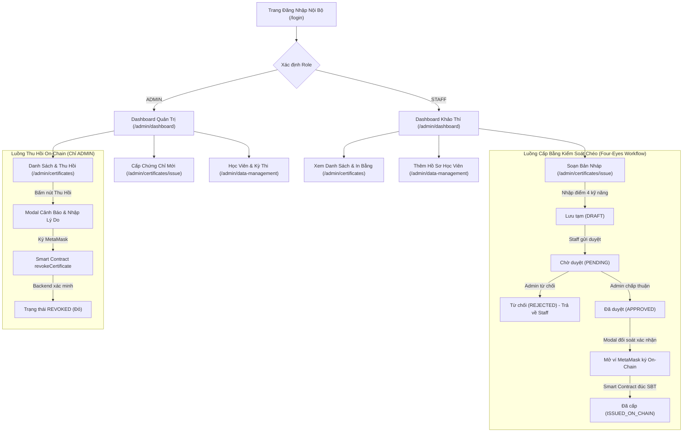

# ĐẶC TẢ GIAO DIỆN & LUỒNG THAO TÁC PHÂN HỆ QUẢN TRỊ (ADMIN UI & WORKFLOWS)
**Hệ Thống Quản Lý & Cấp Phát Chứng Chỉ Tiếng Anh Bằng Blockchain (CertChain)**

> **Phiên bản tài liệu**: 2.1 (Production UI/UX & Flow Specification)  
> **Cập nhật ngày**: 15/11/2026  
> **Đối tượng áp dụng**: Quản trị viên (`ADMIN`), Nhân viên Khảo thí (`STAFF`), Đội ngũ phát triển Frontend & Web3  
> **Mục đích**: Tài liệu hóa chi tiết toàn bộ cấu trúc giao diện, thành phần đồ họa (UI Components), quy tắc tương tác (User Interactions) và luồng nghiệp vụ trên phân hệ Quản trị CertChain (`/admin/*`).

---

## 📑 MỤC LỤC TỔNG QUAN

1. [Tổng Quan Kiến Trúc Giao Diện & Quy Chuẩn Thiết Kế](#1-tổng-quan-kiến-trúc-giao-diện--quy-chuẩn-thiết-kế)
2. [Hành Trình Người Dùng & Sơ Đồ Điều Hướng (User Journey & Navigation Flow)](#2-hành-trình-người-dùng--sơ-đồ-điều-hướng-user-journey--navigation-flow)
3. [Chi Tiết Từng Màn Hình & Thành Phần Giao Diện](#3-chi-tiết-từng-màn-hình--thành-phần-giao-diện)
   - [Màn hình 1: Trang Đăng Nhập Nội Bộ (`/login`)](#màn-hình-1-trang-đăng-nhập-nội-bộ-login)
   - [Màn hình 2: Bảng Điều Khiển Tổng Quan (`/admin/dashboard`)](#màn-hình-2-bảng-điều-khiển-tổng-quan-admindashboard)
   - [Màn hình 3: Màn Hình Soạn Thảo, Đối Soát & Cấp Bằng On-Chain (`/admin/certificates/issue`)](#màn-hình-3-màn-hình-soạn-thảo-đối-soát--cấp-bằng-on-chain-admincertificatesissue)
   - [Màn hình 4: Quản Lý Danh Sách & Thu Hồi Chứng Chỉ (`/admin/certificates`)](#màn-hình-4-quản-lý-danh-sách--thu-hồi-chứng-chỉ-admincertificates)
   - [Màn hình 5: Quản Trị Học Viên & Danh Mục Kỳ Thi / Loại Chứng Chỉ (`/admin/data-management`)](#màn-hình-5-quản-trị-học-viên--danh-mục-kỳ-thi--loại-chứng-chỉ-admindata-management)
4. [Danh Mục Các Thành Phần Giao Diện Dùng Chung (Shared UI Components)](#4-danh-mục-các-thành-phần-giao-diện-dùng-chung-shared-ui-components)
5. [Ma Trận Hiển Thị Giao Diện Theo Vai Trò (UI Visibility by Role)](#5-ma-trận-hiển-thị-giao-diện-theo-vai-trò-ui-visibility-by-role)

---

## 1. TỔNG QUAN KIẾN TRÚC GIAO DIỆN & QUY CHUẨN THIẾT KẾ

Phân hệ Quản trị CertChain áp dụng kiến trúc **Khung làm việc một cột kết hợp thanh điều hướng cố định (Sticky Sidebar Layout)**, tối ưu cho các thao tác quản trị dữ liệu mật độ cao và tương tác ví Web3:

```
+---------------------------------------------------------------------------------------------------------+
|                                    CẤU TRÚC LAYOUT TỔNG THỂ (AdminLayout)                               |
+------------------------------------+--------------------------------------------------------------------+
|  SIDEBAR CỐ ĐỊNH (280px)           |  TOPBAR HEADER (Sticky 64px)                                       |
|  - Brand Header (Logo & Tên app)   |  - Breadcrumbs điều hướng ("Hệ Thống > Bảng Điều Khiển")           |
|  - Role Card (User Name & Role)    |  - ThemeToggle (Nút Dark/Light Mode)                               |
|  - Module Nghiệp Vụ (4 Menu items) |  - Nút Ví MetaMask (Chỉ Admin) / Nhãn Khảo Thí (Staff)             |
|  - Liên Kết Ngoài (Verify, QR)     |  - Nút Đăng Xuất (Logout)                                          |
|  - System Health (Contract, IPFS)  +--------------------------------------------------------------------+
|                                    |  MAIN WORKSPACE (Scrollable Content Body)                          |
|                                    |  - Hiển thị động theo từng Route:                                  |
|                                    |    + /admin/dashboard (Thống kê, Cảnh báo, Công việc cần xử lý)    |
|                                    |    + /admin/certificates (Bảng dữ liệu, Đối soát & Thu hồi)        |
|                                    |    + /admin/certificates/issue (Form nhập & Live Preview dự thảo)  |
|                                    |    + /admin/data-management (Quản lý Học viên & Danh mục kỳ thi)   |
+------------------------------------+--------------------------------------------------------------------+
```

### Quy chuẩn thẩm mỹ & Trải nghiệm người dùng (UX Principles)
* **Giao diện Kép (Dual Theme)**: Hỗ trợ Light Mode (tối ưu cho môi trường văn phòng, độ tương phản cao, bảng biểu sắc nét) và Dark Mode (phong cách Web3 hiện đại).
* **Tiết chế hiệu ứng đồ họa**: Không lạm dụng hiệu ứng kính mờ (Glassmorphism) hay màu neon quá mức để đảm bảo khả năng đọc bảng biểu và văn bản dài.
* **Màu sắc ngữ nghĩa (Semantic Colors)**:
  * **Primary (Xanh lam `#38bdf8`)**: Nhận diện thương hiệu, các nút tác vụ điều hướng.
  * **Success (Xanh lục `#10b981`)**: Chứng chỉ hợp lệ on-chain (`ISSUED_ON_CHAIN`), kết nối mạng tốt.
  * **Warning (Vàng cam `#f59e0b`)**: Bản nháp chờ kiểm duyệt (`PENDING`), bản xem trước (`DRAFT PREVIEW`).
  * **Danger (Đỏ `#ef4444`)**: Chứng chỉ bị thu hồi (`REVOKED`), hồ sơ bị từ chối (`REJECTED`), cảnh báo bất biến.
* **Định danh công nghệ chuẩn xác**: Chứng chỉ được phát hành dưới dạng **NFT dựa trên chuẩn ERC-721 mở rộng cơ chế Soulbound (theo tinh thần EIP-5192 / non-transferable override)** nhằm khóa vĩnh viễn quyền chuyển nhượng giữa các ví.

---

## 2. HÀNH TRÌNH NGƯỜI DÙNG & SƠ ĐỒ ĐIỀU HƯỚNG (USER JOURNEY & NAVIGATION FLOW)



---

## 3. CHI TIẾT TỪNG MÀN HÌNH & THÀNH PHẦN GIAO DIỆN

---

### MÀN HÌNH 1: TRANG ĐĂNG NHẬP NỘI BỘ (`/login`)

#### 1. Bố cục & Thành phần giao diện (UI Components)
* **Khung đăng nhập trung tâm (Center Auth Card)**:
  * **Brand Header**: Icon khiên bảo vệ `ShieldCheck` phát sáng, tiêu đề **CERTCHAIN** kèm chú thích *"Cổng Đăng Nhập Cán Bộ & Quản Trị Viên"*.
  * **Trường Tên đăng nhập**: Input text có icon `@`, placeholder `VD: admin_khoa hoặc staff_long`.
  * **Trường Mật khẩu**: Input password có icon chìa khóa `Lock` và nút con mắt bật/tắt hiển thị mật khẩu.
  * **Nút bấm chính (Submit Button)**: Nút màu xanh `btn-primary` toàn chiều rộng: *"Xác Nhận Đăng Nhập"*.
  * **Khu vực Demo Quick-Fill**: Chỉ hiển thị **2 vai trò nội bộ hợp lệ**:
    1. `🛡️ Quản trị viên (Admin)`: Tự động điền `admin_khoa` / `123456`.
    2. `💼 Nhân viên Khảo thí (Staff)`: Tự động điền `staff_long` / `123456`.
    *(Lưu ý: Nút Học viên đã được loại bỏ khỏi cổng đăng nhập quản trị. Học viên tra cứu văn bằng công khai tại Cổng Thẩm Định `/verify` mà không cần tài khoản nội bộ).*
  * **Thông báo lỗi (Error Alert)**: Banner màu đỏ hiển thị khi sai thông tin hoặc tài khoản bị khóa.

#### 2. Luồng thao tác (User Interactions)
1. Cán bộ truy cập route `/login`.
2. Click nút Quick-Fill hoặc tự gõ tài khoản $\to$ Bấm **"Xác Nhận Đăng Nhập"**.
3. Frontend gửi request `POST /api/auth/login`. Backend xác thực BCrypt và trả về JWT Token cùng User profile.
4. Lưu session vào `localStorage` $\to$ Chuyển hướng tức thì sang `/admin/dashboard`.

---

### MÀN HÌNH 2: BẢNG ĐIỀU KHIỂN TỔNG QUAN (`/admin/dashboard`)

#### 1. Bố cục & Thành phần giao diện (UI Components)

```
+---------------------------------------------------------------------------------------------------+
| [TIÊU ĐỀ CHÀO MỪNG] Bảng Điều Khiển Quản Trị              [NÚT TẮC VỤ: Cấp Bằng | Danh Sách | Data] |
| Xin chào, Quản trị viên Khoa • Thẩm quyền: [ADMIN]                                                |
+---------------------------------------------------------------------------------------------------+
| [BANNER TRẠNG THÁI WEB3]                                                                          |
| Mạng: Hardhat Localhost (Chain ID 31337) • Smart Contract: Kết nối sẵn sàng • IPFS: Hoạt động      |
+---------------------------------+---------------------------------+-------------------------------+
| THẺ 1: TỔNG CHỨNG CHỈ           | THẺ 2: ĐÃ CẤP ON-CHAIN          | THẺ 3: CHỜ PHÊ DUYỆT (PENDING)|
| [Icon Award] 6 Văn bằng         | [Icon Check] 4 Token hợp lệ     | [Icon Clock] 1 Đang chờ duyệt |
+---------------------------------+---------------------------------+-------------------------------+
| THẺ 4: ĐÃ THU HỒI (REVOKED)                                                                       |
| [Icon XCircle] 1 Chứng chỉ đã vô hiệu hóa on-chain                                                |
+---------------------------------------------------------------------------------------------------+
| KHU VỰC CÔNG VIỆC CẦN XỬ LÝ (ACTION ITEMS)                                                        |
| 🔔 Có 1 hồ sơ PENDING cần Quản trị viên đối soát và phê duyệt cấp bằng on-chain                   |
| ⚠️ Phát hiện 0 giao dịch lỗi lệch pha giữa MySQL và Blockchain                                    |
+--------------------------------------------------+------------------------------------------------+
| BIỂU ĐỒ PHÂN BỐ KỲ THI (Exam Type Distribution)  | NHẬT KÝ KIỂM TOÁN GẦN ĐÂY (Recent Audit Logs)  |
| - IELTS Academic: 40%                            | [15:42] Admin đúc On-chain mã CERT-IELTS-001   |
| - TOEIC 4-Skills: 30%                            | [14:20] Staff Long tạo nháp mã CERT-TOEIC-088  |
| - VSTEP Bậc 5 (C1): 20%                          | [11:15] Admin thu hồi mã CERT-VSTEP-012        |
| - Cambridge CAE: 10%                             |                                                |
+--------------------------------------------------+------------------------------------------------+
```

* **Thẻ Thống Kê KPI (Counter Cards - Đúng chuẩn 4 thẻ)**:
  1. *Tổng số chứng chỉ*: Màu xanh dương, icon `Award`.
  2. *Đã phát hành On-Chain*: Màu xanh ngọc lục bảo, icon `CheckCircle2`.
  3. *Bản nháp chờ duyệt (`PENDING`)*: Màu vàng hổ phách, icon `Clock`.
  4. *Đã thu hồi (`REVOKED`)*: Màu đỏ, icon `XCircle`.
* **Khu vực Công Việc Cần Xử Lý (Action Required Area)**:
  * Hiển thị danh sách hồ sơ cần Admin phê duyệt, các giao dịch lỗi hoặc bản ghi cần chạy đối soát on-chain.
* **Bảng Phát Hành Gần Đây & Nhật Ký Kiểm Toán (Recent Activity Table)**:
  * 5 dòng thao tác mới nhất từ bảng `issue_logs` hiển thị: Mã bằng, Người thực hiện, Hành động, Thời gian và Nhãn trạng thái màu sắc.

---

### MÀN HÌNH 3: MÀN HÌNH SOẠN THẢO, ĐỐI SOÁT & CẤP BẰNG ON-CHAIN (`/admin/certificates/issue`)

Được thiết kế theo cấu trúc **2 cột song song (Split Screen Layout)**:
* **Cột trái (50%)**: Form nhập liệu nghiệp vụ & Động cơ tính điểm chuẩn hóa.
* **Cột phải (50%)**: Khung xem trước trực quan thời gian thực (Live Preview phôi bằng dự thảo).

```
+------------------------------------------------------+------------------------------------------------------+
|  CỘT TRÁI: FORM NHẬP LIỆU NGHIỆP VỤ                  |  CỘT PHẢI: LIVE PREVIEW DỰ THẢO (DRAFT PREVIEW)      |
+------------------------------------------------------+------------------------------------------------------+
|  [MÃ BẰNG]: CERT-IELTS-2026-950 (Tự động sinh)       |  ┌────────────────────────────────────────────────┐  |
|                                                      |  │     INTERNATIONAL ENGLISH TESTING CENTER       │  |
|  [CHỌN HỌC VIÊN]: Dropdown học viên có sẵn           |  │                                                │  |
|  Họ tên: Phạm Quốc Hưng   | Mã HV: HV2026-0199       |  │           CERTIFICATE OF PROFICIENCY           │  |
|                                                      |  │                                                │  |
|  [CHỌN KỲ THI]: IELTS Academic Master                |  │             PHẠM QUỐC HƯNG                     │  |
|                                                      |  │             Mã học viên: HV2026-0199           │  |
|  [ĐIỂM SỐ OVERALL]: 🔒 [7.5 Overall] (Khóa sửa tay)  |  │                                                │  |
|                                                      |  │  OVERALL   Listening  Reading  Writing Speaking│  |
|  [ĐIỂM 4 KỸ NĂNG] (🔒 Niêm phong Four-Eyes cho Admin)|  │    7.5        8.0      7.5      7.0     7.5  │  |
|  [L: 8.0]   [R: 7.5]   [W: 7.0]   [S: 7.5]           |  │                                                │  |
|                                                      |  │  TRẠNG THÁI: ⚠️ BẢN XEM TRƯỚC   [MÃ QR MÔ PHỎNG]│  |
|  [NGÀY THI]: 15/11/2026  | [HẠN DÙNG]: 15/11/2028    |  │  (Chờ đúc on-chain)             (Chờ cấp URL)  │  |
|                                                      |  └────────────────────────────────────────────────┘  |
|  [ĐỊA CHỈ VÍ METAMASK HỌC VIÊN] (EIP-55 Checksum)    |                                                      |
|  0x9965507d1a55bcc2695c58ba16Fb37D819b0A4dF         |  [BẰNG CHỨNG BLOCKCHAIN DỰ THẢO]                     |
|                                                      |  - Token ID: Chờ cấp sau khi ký On-Chain             |
|  NÚT HÀNH ĐỘNG PHÂN QUYỀN:                           |  - Tx Hash: Chưa phát sinh • IPFS: Đang chuẩn bị     |
|  - ADMIN: [Ký MetaMask & Cấp Bằng On-Chain (Cam)]   |                                                      |
|  - STAFF: [Lưu Bản Nháp Chờ Admin Duyệt (Vàng)]      |                                                      |
+------------------------------------------------------+------------------------------------------------------+
```

#### Các thành phần giao diện đặc thù & Quy tắc bảo mật:
1. **Khóa cứng ô "Điểm số Overall" (`readOnly` 100%)**:
   * Có badge: `🔒 Tự động tính toán (Không thể sửa tay)`.
   * **Tách biệt thuật toán tính điểm theo từng kỳ thi**:
     * **IELTS**: Trung bình cộng 4 kỹ năng làm tròn theo band: phần thập phân $<0.25 \to .0$; $0.25 \le \text{dec} < 0.75 \to .5$; $\ge 0.75 \to$ làm tròn lên bậc nguyên.
     * **TOEIC**: Tổng điểm Nghe (5-495) + Đọc (5-495) theo thang điểm 990.
     * **VSTEP**: Trung bình cộng 4 kỹ năng làm tròn đến 0.5; phân bậc rõ: Bậc 3 (B1: 4.0 - 5.5), Bậc 4 (B2: 6.0 - 8.0), Bậc 5 (C1: 8.5 - 10.0).
     * **Cambridge**: Tính theo Cambridge English Scale (160 - 210) phân loại Grade A/B/C.
2. **Khóa Niêm Phong Điểm Số Theo Nguyên Tắc Bốn Mắt (Four-Eyes Locking)**:
   * Khi đăng nhập bằng `ADMIN`: 4 ô điểm kỹ năng **bị khóa hoàn toàn (`readOnly`, con trỏ `not-allowed`)**, kèm banner:
     > 🔒 **Nguyên tắc Bốn Mắt (Four-Eyes):** Dữ liệu điểm do Nhân viên Khảo thí nhập liệu đã được niêm phong. Quản trị viên chỉ đối soát, phê duyệt và ký phát hành on-chain, không được tự ý sửa điểm. Nếu điểm sai, vui lòng từ chối bản nháp để Khảo thí điều chỉnh lại.
   * **Không có checkbox tự mở khóa sửa điểm** nhằm ngăn ngừa triệt để nguy cơ Admin tự ý thao túng kết quả rồi tự duyệt.
3. **Phôi Bằng Xem Trước (Draft Preview Watermark)**:
   * Trong giai đoạn soạn thảo hoặc khi chưa đúc on-chain, phôi bằng hiển thị watermark và badge cảnh báo rõ ràng:
     `⚠️ BẢN XEM TRƯỚC – CHƯA PHÁT HÀNH (DRAFT PREVIEW)`.
   * Mục Blockchain hiển thị: `Token ID: Chờ cấp sau khi đúc on-chain`, `Tx Hash: Chưa phát sinh`, `Mã QR mô phỏng`. Tuyệt đối không khẳng định chứng chỉ đã hợp lệ on-chain khi chưa có transaction receipt.
4. **Modal Đối Soát Trước Khi Ký MetaMask (Pre-Mint Review Modal)**:
   * Khi Admin bấm "Ký MetaMask & Cấp Bằng On-Chain", hệ thống bật Modal tổng hợp thông tin: Tên học viên, Mã số, Loại kỳ thi, Bảng điểm 4 kỹ năng, Điểm Overall, Ngày thi, Địa chỉ ví nhận.
   * Admin bấm **"Xác Nhận & Mở Ví Ký MetaMask"** thì popup ví mới xuất hiện, loại trừ rủi ro ký nhầm hồ sơ.

---

### MÀN HÌNH 4: QUẢN LÝ DANH SÁCH & THU HỒI CHỨNG CHỈ (`/admin/certificates`)

#### 1. Bố cục & Thành phần giao diện (UI Components)
* **Thanh tìm kiếm & Bộ lọc đa chiều**:
  * Tìm kiếm nhanh theo Mã bằng, Tên học viên, Mã số học viên.
  * **Bộ lọc trạng thái đầy đủ 5 trạng thái**:
    1. `ALL`: Tất cả trạng thái
    2. `ISSUED_ON_CHAIN`: Hợp lệ On-Chain (Xanh lá)
    3. `PENDING`: Chờ kiểm duyệt (Vàng)
    4. `REJECTED`: Bị từ chối (Đỏ nhạt)
    5. `REVOKED`: Đã thu hồi (Đỏ thẫm)
    6. `EXPIRED`: Đã hết hạn hiệu lực (Xám)
  * Bộ lọc Kỳ thi: IELTS Academic, TOEIC 4 Kỹ Năng, VSTEP B2-C1, Cambridge CAE.
* **Cột Thao Tác (Action Buttons)**:
  * 👁️ **Xem PDF**: Mở Modal xem trước tệp PDF vector 300 DPI kèm mã QR.
  * 🔗 **Explorer**: Mở liên kết tra cứu giao dịch trên mạng Blockchain.
  * 🔄 **Đối Soát On-Chain (Reconcile)**: Gửi request về Backend (`/api/certificates/:id/reconcile`) để tự động đọc Smart Contract và đồng bộ trạng thái về MySQL nếu có sự cố rớt mạng khi đào block.
  * 🚫 **Thu Hồi (Chỉ ADMIN)**: Mở Modal thu hồi chứng chỉ khi có gian lận quy chế thi.

#### 2. Modal Thu Hồi On-Chain (Revocation Modal with Safety Checklist)
* **Checklist đối soát 4 bước**: Hiển thị cố định Mã bằng, Tên học sinh, Token ID và Tx Hash phát hành ban đầu để Admin đối chiếu lần cuối.
* **Ô nhập Lý do thu hồi bắt buộc (Revoke Reason)**: Nút ký ví bị khóa mờ (`disabled`) cho đến khi Admin nhập tối thiểu 10 ký tự lý do chính đáng.
* **Bản chất pháp lý**: Trạng thái thu hồi đã ghi nhận trên Blockchain là vĩnh viễn không thể xóa khỏi sổ cái lịch sử. Nếu có sai sót cần cấp lại, trung tâm phải thực hiện quy trình phát hành chứng chỉ mới liên kết trường `replaces_certificate_id`.

---

### MÀN HÌNH 5: QUẢN TRỊ HỌC VIÊN & DANH MỤC KỲ THI / LOẠI CHỨNG CHỈ (`/admin/data-management`)

#### 1. Bố cục Tabs Chuyển Đổi
* **Tab 1: Danh Sách Học Viên (`STUDENTS`)**:
  * Quản lý hồ sơ người học: Mã HV, Họ tên, Email, Ngày sinh, Số điện thoại, Địa chỉ ví MetaMask.
  * Số CCCD/CMND được lưu bảo mật trong MySQL nội bộ, **tuyệt đối không đưa lên Blockchain công khai**.
  * Kiểm tra tự động địa chỉ ví bằng chuẩn EIP-55 Checksum.
* **Tab 2: Danh Mục Kỳ Thi & Loại Chứng Chỉ (`EXAMS / CERTIFICATES`)**:
  * *(Phân biệt rõ ràng giữa "Khóa học đào tạo" và "Loại chứng chỉ / Kỳ thi khảo thí")*.
  * Cấu hình thang điểm chuẩn (`IELTS`, `TOEIC`, `VSTEP`, `CAMBRIDGE`) và thời hạn hiệu lực mặc định (2 năm hoặc vĩnh viễn).
  * Chỉ Quản trị viên (`ADMIN`) mới có quyền thêm mới hoặc điều chỉnh danh mục kỳ thi.

---

## 4. DANH MỤC CÁC THÀNH PHẦN GIAO DIỆN DÙNG CHUNG (SHARED UI COMPONENTS)

| Mã Component | Tên Component React | Mục Đích Sử Dụng | Các Thuộc Tính Đầu Vào (Props) |
| :---: | :--- | :--- | :--- |
| **C-01** | `AdminLayout` | Khung sườn tổng thể bao bọc toàn bộ phân hệ Admin (Sidebar, Topbar, Breadcrumbs, System status). | `children`, `wallet`, `setWallet`, `user`, `setUser` |
| **C-02** | `ThemeToggle` | Nút công tắc chuyển đổi Light Mode $\leftrightarrow$ Dark Mode lưu trạng thái trong `localStorage`. | Không có |
| **C-03** | `CertificateCard` | Khung đồ họa phôi bằng vector viền cổ điển, hiển thị tem nổi, bảng điểm, watermark dự thảo và mã QR nhúng URL xác thực. | `certData`, `isPreview` |
| **C-04** | `StatusTag` | Nhãn trạng thái màu sắc chuẩn: `ISSUED_ON_CHAIN` (Xanh lá), `PENDING` (Vàng), `REJECTED` (Đỏ nhạt), `REVOKED` (Đỏ thẫm), `EXPIRED` (Xám). | `status`, `showIcon` |
| **C-05** | `PreMintModal` | Modal đối soát dữ liệu học viên, điểm số và ví nhận trước khi gọi chữ ký MetaMask. | `isOpen`, `certData`, `onConfirm`, `onClose` |
| **C-06** | `RevokeModal` | Hộp thoại cảnh báo và nhập lý do thu hồi chứng chỉ bất biến on-chain. | `isOpen`, `targetCert`, `onConfirmRevoke`, `onClose` |

---

## 5. MA TRẬN HIỂN THỊ GIAO DIỆN THEO VAI TRÒ (UI VISIBILITY BY ROLE)

| Vị Trí Giao Diện | Thành Phần Giao Diện (UI Element) | Khi Đăng Nhập `ADMIN` (Quản trị viên) | Khi Đăng Nhập `STAFF` (Nhân viên Khảo thí) |
| :--- | :--- | :---: | :---: |
| **Thanh Header** | Nút kết nối "Ví MetaMask (Admin)" | ✅ Hiển thị (Có địa chỉ ví & số dư ETH) | ❌ Ẩn (Thay bằng nhãn `Nhân viên Khảo thí (Staff)`) |
| **Sidebar Menu** | Huy hiệu tại menu "Cấp Chứng Chỉ Mới" | 🏷️ Nhãn vàng: **`Đúc On-Chain`** | 🏷️ Nhãn lam: **`Soạn Nháp`** |
| **Dashboard** | Banner trạng thái mạng Web3 | ✅ Hiển thị trạng thái kết nối ví Admin | ℹ️ Hiển thị Hướng dẫn nghiệp vụ Khảo thí |
| **Màn Hình Cấp Bằng** | Nút hành động chính dưới chân form | 🟧 Nút màu cam: **"Ký MetaMask & Cấp Bằng"** | 🟨 Nút màu vàng: **"Lưu Bản Nháp (PENDING)"** |
| **Màn Hình Cấp Bằng** | 4 ô điểm kỹ năng thành phần | 🔒 **Khóa niêm phong Four-Eyes** (`readOnly`) | ✍️ **Cho phép nhập liệu điểm thi** |
| **Màn Hình Cấp Bằng** | Ô Điểm số Overall | 🔒 **Khóa cứng `readOnly` 100%** | 🔒 **Khóa cứng `readOnly` 100%** |
| **Danh Sách Bằng** | Nút bấm thao tác "Thu Hồi Chứng Chỉ" | 🔴 **Hiển thị nút "Thu Hồi" (Ký On-chain)** | ❌ **Ẩn hoàn toàn nút Thu Hồi** |
| **Quản Lý Kỳ Thi** | Nút bấm "+ Thêm Kỳ Thi / Chứng Chỉ Mới" | ✅ Cho phép thêm và cấu hình kỳ thi | ❌ Bị ẩn (Chỉ xem danh mục) |
| **Quản Lý Học Viên** | Nút bấm "+ Thêm Học Viên Mới" | ✅ Cho phép thêm hồ sơ học viên | ✅ Cho phép thêm hồ sơ học viên |

---

> 📌 **Tài liệu tham chiếu mã nguồn**:
> - [Khung Giao Diện Quản Trị (AdminLayout.jsx)](file:///D:/blockchain/blockchain-english-certificates/frontend/src/components/AdminLayout.jsx)
> - [Màn Hình Cấp Bằng & Live Preview (IssueCertPage.jsx)](file:///D:/blockchain/blockchain-english-certificates/frontend/src/pages/IssueCertPage.jsx)
> - [Thẻ Đồ Họa Phôi Bằng (CertificateCard.jsx)](file:///D:/blockchain/blockchain-english-certificates/frontend/src/components/CertificateCard.jsx)
> - [Màn Hình Danh Sách & Modal Thu Hồi (CertificatesListPage.jsx)](file:///D:/blockchain/blockchain-english-certificates/frontend/src/pages/CertificatesListPage.jsx)
> - [Đặc Tả Luồng Nghiệp Vụ Quản Trị Chi Tiết (LUONG_HOAT_DONG_CHI_TIET_ADMIN.md)](file:///D:/blockchain/blockchain-english-certificates/docs/LUONG_HOAT_DONG_CHI_TIET_ADMIN.md)
