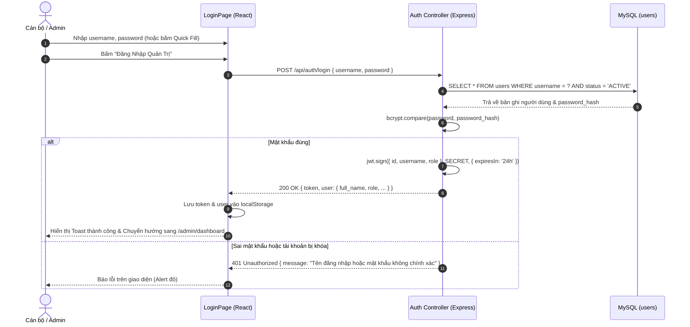
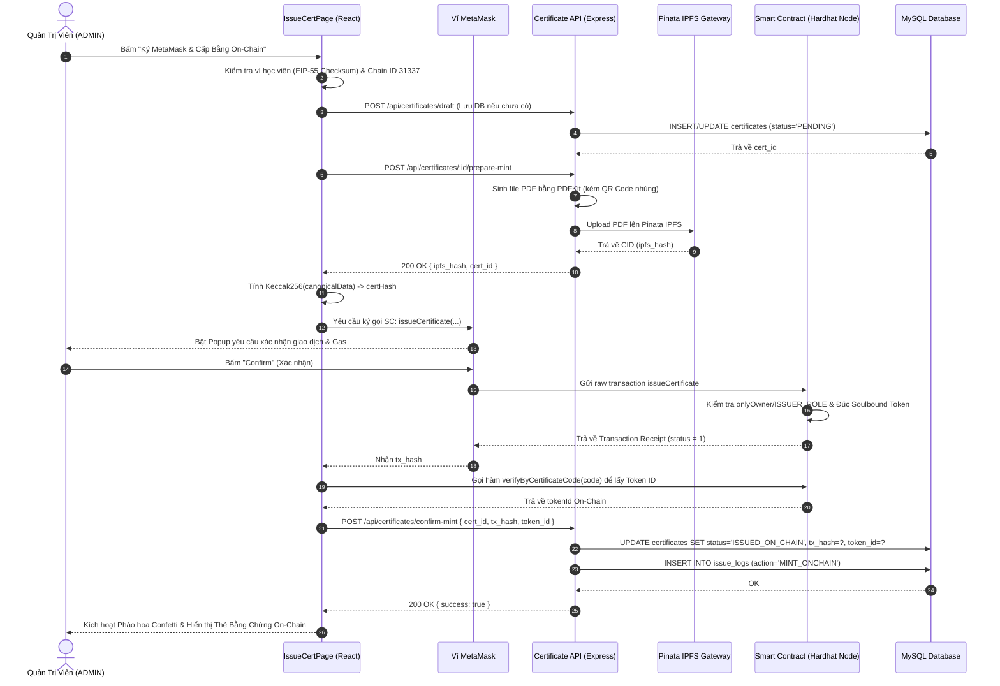
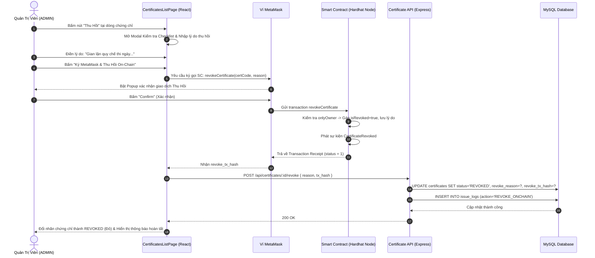
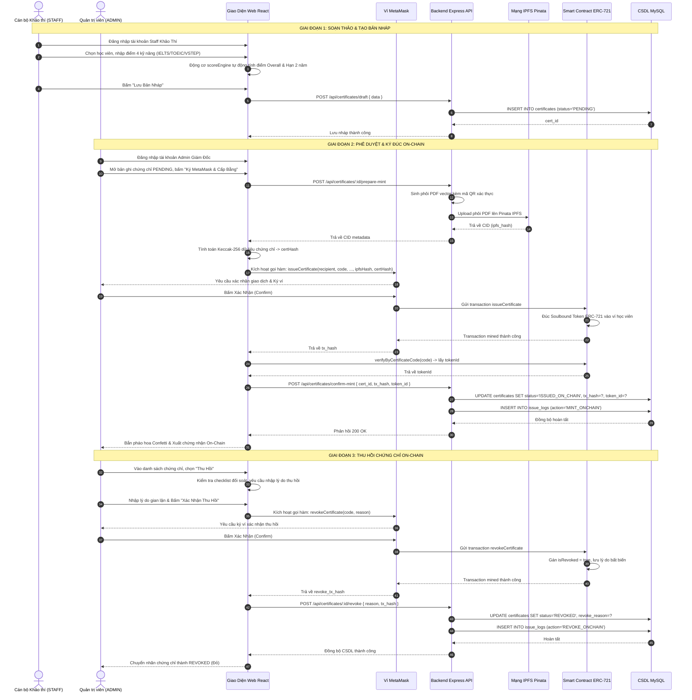

# TÀI LIỆU LUỒNG HOẠT ĐỘNG CHI TIẾT TỪNG CHỨC NĂNG PHÂN HỆ QUẢN TRỊ (ADMIN PORTAL)
**Hệ Thống Quản Lý & Cấp Phát Chứng Chỉ Tiếng Anh Bằng Blockchain (CertChain)**

> **Phiên bản tài liệu**: 2.1 (Admin Specification & Workflow)  
> **Cập nhật ngày**: 15/11/2026  
> **Dành cho**: Cán bộ Quản trị (`ADMIN`), Cán bộ Khảo thí (`STAFF`), Hội đồng chấm nghiệm thu đề tài  
> **Áp dụng tại**: Phân hệ Quản trị CertChain (`/admin/*`)

---

## 📑 MỤC LỤC TỔNG QUAN

1. [Tổng Quan Phân Hệ Quản Trị & Ma Trận Phân Quyền (RBAC)](#1-tổng-quan-phân-hệ-quản-trị--ma-trận-phân-quyền-rbac)
2. [Chi Tiết Luồng Hoạt Động Từng Chức Năng Admin](#2-chi-tiết-luồng-hoạt-động-từng-chức-năng-admin)
   - [Chức năng 1: Đăng Nhập & Quản Lý Phiên Làm Việc (Auth & Session)](#chức-năng-1-đăng-nhập--quản-lý-phiên-làm-việc-auth--session)
   - [Chức năng 2: Giám Sát Dashboard & Kết Nối Mạng Web3 (Dashboard & Web3 Health Monitor)](#chức-năng-2-giám-sát-dashboard--kết-nối-mạng-web3-dashboard--web3-health-monitor)
   - [Chức năng 3: Soạn Thảo, Chấm Điểm & Lập Bản Nháp (Staff Draft Workflow)](#chức-năng-3-soạn-thảo-chấm-điểm--lập-bản-nháp-staff-draft-workflow)
   - [Chức năng 4: Phê Duyệt, Ký MetaMask & Đúc Soulbound Token On-Chain (Admin Minting Workflow)](#chức-năng-4-phê-duyệt-ký-metamask--đúc-soulbound-token-on-chain-admin-minting-workflow)
   - [Chức năng 5: Quản Lý Danh Sách & Lọc Đa Chiều Chứng Chỉ (Certificate Directory)](#chức-năng-5-quản-lý-danh-sách--lọc-đa-chiều-chứng-chỉ-certificate-directory)
   - [Chức năng 6: Xem Trước Phôi Bằng PDF & In Ấn Trực Tuyến (In-browser Inspection & Print)](#chức-năng-6-xem-trước-phôi-bằng-pdf--in-ấn-trực-tuyến-in-browser-inspection--print)
   - [Chức năng 7: Quy Trình Thu Hồi Bằng On-Chain Chống Chối Bỏ (Revocation Workflow)](#chức-năng-7-quy-trình-thu-hồi-bằng-on-chain-chống-chối-bỏ-revocation-workflow)
   - [Chức năng 8: Quản Lý Hồ Sơ Học Viên & Danh Mục Khóa Học (Data Management)](#chức-năng-8-quản-lý-hồ-sơ-học-viên--danh-mục-khóa-học-data-management)
3. [Cỗ Máy Trạng Thái Chứng Chỉ (State Machine)](#3-cỗ-máy-trạng-thái-chứng-chỉ-state-machine)
4. [Sơ Đồ Tuần Tự Tổng Hợp (Master Sequence Diagram)](#4-sơ-đồ-tuần-tự-tổng-hợp-master-sequence-diagram)
5. [Cơ Chế Xử Lý Lỗi & Ngoại Lệ Thường Gặp (Troubleshooting Guide)](#5-cơ-chế-xử-lý-lỗi--ngoại-lệ-thường-gặp-troubleshooting-guide)

---

## 1. TỔNG QUAN PHÂN HỆ QUẢN TRỊ & MA TRẬN PHÂN QUYỀN (RBAC)

Phân hệ Quản trị (**Admin Portal**) là trung tâm điều hành nghiệp vụ cấp phát, thẩm tra và quản lý vòng đời của chứng chỉ tiếng Anh (IELTS, TOEIC, VSTEP, Cambridge, TOEFL). Hệ thống áp dụng mô hình bảo vệ **3 lớp nghiêm ngặt**:

```
+-----------------------------------------------------------------------------------+
|  LỚP 1: GIAO DIỆN REACT (UI Guard & Dynamic Role Visibility)                      |
|  - Ẩn/hiện nút Web3, nút Ký On-Chain theo Role đăng nhập                          |
|  - Kiểm tra kết nối MetaMask và chuyển mạng Chain ID 31337 tự động                |
+-----------------------------------------------------------------------------------+
                                      │
                                      ▼
+-----------------------------------------------------------------------------------+
|  LỚP 2: BACKEND NODE.JS EXPRESS (JWT Auth + RBAC Middleware)                      |
|  - Xác thực Bearer JWT Header (`authMiddleware.js`)                               |
|  - Kiểm tra quyền hạn `requireRole(['ADMIN'])` (`rbac.middleware.js`)            |
|  - Ghi vết mọi hành vi vào nhật ký kiểm toán `issue_logs`                         |
+-----------------------------------------------------------------------------------+
                                      │
                                      ▼
+-----------------------------------------------------------------------------------+
|  LỚP 3: SMART CONTRACT SOLIDITY (On-Chain AccessControl & Ownable)                |
|  - Kiểm tra `msg.sender == owner()` hoặc `hasRole(ISSUER_ROLE, msg.sender)`       |
|  - Khóa vĩnh viễn quyền chuyển nhượng Soulbound Token (Non-Transferable ERC-721)  |
|  - Ghi nhận Transaction Receipt và Event bất biến trên chuỗi                      |
+-----------------------------------------------------------------------------------+
```

### 1.1 Phân định vai trò người dùng (User Roles)

* **Quản trị viên (`ADMIN`)**:
  * Đại diện: Giám đốc trung tâm / Trưởng ban Quản trị khảo thí (Tài khoản demo: `admin_khoa` hoặc `admin`).
  * Nắm giữ Private Key của ví Web3 Deployer (`0xf39Fd6e51aad88F6F4ce6aB8827279cffFb92266`).
  * Toàn quyền: Xem Dashboard, Đúc On-chain Soulbound Token, Ký MetaMask Thu hồi bằng, Thêm khóa học và học viên.
* **Cán bộ Khảo thí (`STAFF`)**:
  * Đại diện: Chuyên viên phụ trách nhập điểm, thư ký phòng thi (Tài khoản demo: `staff_long`, `staff_lan`).
  * Quyền hạn: Xem Dashboard, Soạn thảo hồ sơ chứng chỉ, Lập bản nháp (`PENDING`), Thêm học viên mới, In phôi bằng PDF.
  * Hạn chế: **Không có quyền ký ví MetaMask để phát hành hay thu hồi On-Chain** (Tránh phát sinh phí gas trái phép hoặc gian lận đúc bằng).

### 1.2 Ma trận phân quyền chi tiết (RBAC Matrix)

| STT | Tên Chức Năng Quản Trị | Route / Endpoint | Quyền `ADMIN` | Quyền `STAFF` | Yêu Cầu Ví MetaMask |
| :---: | :--- | :--- | :---: | :---: | :---: |
| 1 | Đăng nhập hệ thống nội bộ | `/login` (`POST /api/auth/login`) | ✅ Cho phép | ✅ Cho phép | ❌ Không |
| 2 | Giám sát Dashboard & Web3 | `/admin/dashboard` | ✅ Cho phép | ✅ Cho phép (Ẩn cảnh báo ví) | Khuyến nghị ADMIN |
| 3 | Lập bản nháp chứng chỉ (`PENDING`) | `/admin/certificates/issue` | ✅ Cho phép | ✅ Cho phép | ❌ Không |
| 4 | Ký MetaMask đúc On-chain Soulbound | `/admin/certificates/issue` | ✅ Cho phép | ❌ Bị chặn (Chỉ lưu nháp) | ✅ Bắt buộc (Ví Admin) |
| 5 | Tra cứu danh sách & Bộ lọc đa chiều | `/admin/certificates` | ✅ Cho phép | ✅ Cho phép | ❌ Không |
| 6 | Xem trước phôi PDF & In ấn | `/admin/certificates` (`Modal`) | ✅ Cho phép | ✅ Cho phép | ❌ Không |
| 7 | Ký MetaMask thu hồi chứng chỉ On-Chain | `/admin/certificates` (`Revoke`) | ✅ Cho phép | ❌ Bị chặn (Ẩn nút) | ✅ Bắt buộc (Ví Admin) |
| 8 | Thêm mới hồ sơ học viên | `/admin/data-management` | ✅ Cho phép | ✅ Cho phép | ❌ Không |
| 9 | Thêm mới danh mục khóa học | `/admin/data-management` | ✅ Cho phép | ❌ Bị chặn | ❌ Không |

---

## 2. CHI TIẾT LUỒNG HOẠT ĐỘNG TỪNG CHỨC NĂNG ADMIN

---

### CHỨC NĂNG 1: ĐĂNG NHẬP & QUẢN LÝ PHIÊN LÀM VIỆC (AUTH & SESSION)

#### 1. Mục đích & Tác nhân
* **Mục đích**: Xác thực định danh cán bộ trung tâm, cấp phát JWT Token làm bằng chứng truy cập bảo mật và điều hướng chính xác theo vai trò nghiệp vụ.
* **Tác nhân**: Cán bộ Khảo thí (`STAFF`) hoặc Quản trị viên (`ADMIN`).

#### 2. Dữ liệu Đầu vào & Đầu ra
* **Đầu vào (Input)**:
  * Tên đăng nhập (`username`): e.g., `admin_khoa`, `staff_long`.
  * Mật khẩu (`password`): e.g., `123456`.
  * Nút chọn nhanh (Quick-fill demo buttons): Admin Giám Đốc, Staff Khảo Thí, Học Viên.
* **Đầu ra (Output)**:
  * `token`: JSON Web Token (JWT) có thời hạn 24h.
  * `user`: Object `{ id, username, full_name, email, role, status }`.
  * Chuyển hướng trình duyệt đến `/admin/dashboard`.

#### 3. Các bước xử lý chi tiết (Step-by-Step)
1. Người dùng truy cập route `/login`.
2. Điền thông tin đăng nhập hoặc bấm các nút chọn nhanh để điền tài khoản mẫu.
3. Nhấn **"Đăng Nhập Quản Trị"**.
4. Client gửi request `POST /api/auth/login` kèm payload `{ username, password }`.
5. Backend xử lý:
   * Tìm người dùng trong bảng `users` theo `username` với điều kiện `status = 'ACTIVE'`.
   * So sánh mật khẩu băm bằng `bcrypt.compare(password, user.password_hash)`.
   * Nếu hợp lệ: Ký JWT chứa `{ id, username, role }` bằng `JWT_SECRET`.
   * Trả về HTTP 200 kèm `token` và thông tin `user`.
6. Frontend lưu thông tin vào `localStorage.setItem("certchain_auth", JSON.stringify(data))`.
7. `App.jsx` cập nhật state `currentUser`, điều hướng người dùng sang `/admin/dashboard`.
8. Nếu phiên hết hạn hoặc đăng xuất: `logout()` xóa khóa lưu trữ, hủy bỏ quyền gọi API và quay về `/login`.



---

### CHỨC NĂNG 2: GIÁM SÁT DASHBOARD & KẾT NỐI MẠNG WEB3 (DASHBOARD & WEB3 HEALTH MONITOR)

#### 1. Mục đích & Tác nhân
* **Mục đích**: Cung cấp bức tranh tổng thể về tình hình cấp chứng chỉ, tỷ lệ phân bố giữa các kỳ thi tiếng Anh, nhật ký kiểm toán mới nhất, đồng thời giám sát sức khỏe kết nối giữa trình duyệt và Smart Contract trên Blockchain.
* **Tác nhân**: Cán bộ Quản trị (`ADMIN`) và Cán bộ Khảo thí (`STAFF`).

#### 2. Dữ liệu Đầu vào & Đầu ra
* **Đầu vào (Input)**:
  * Trạng thái ví MetaMask (Địa chỉ ví đang kích hoạt, Mạng Chain ID).
  * Lời gọi API thống kê: `GET /api/dashboard/stats`, `GET /api/dashboard/recent-activity`.
* **Đầu ra (Output)**:
  * 4 thẻ thống kê tổng quan: Tổng chứng chỉ, Đã cấp On-Chain (`ISSUED_ON_CHAIN`), Đang chờ duyệt (`PENDING`), Bị thu hồi (`REVOKED`).
  * Biểu đồ tỷ lệ phân bố kỳ thi (IELTS, TOEIC, VSTEP, Cambridge, TOEFL).
  * Bảng dòng thời gian 5 hành vi nghiệp vụ gần nhất từ bảng `issue_logs`.
  * Banner thông báo trạng thái ví:
    * `ADMIN`: Xác nhận ví Issuer `0xf39F...2266` kết nối đúng Chain 31337 (Màu xanh) hoặc cảnh báo kết nối (Màu vàng).
    * `STAFF`: Hiển thị hướng dẫn nghiệp vụ dành riêng cho Cán bộ khảo thí (Màu xanh lam nhẹ nhàng).

#### 3. Các bước xử lý chi tiết (Step-by-Step)
1. Khi load trang `/admin/dashboard`, `useEffect` đồng thời kích hoạt 2 luồng:
   * **Luồng Web3**: Gọi `connectMetaMask()` để kiểm tra tiện ích mở rộng MetaMask. Đọc `network.chainId` và `signer.getAddress()`. Đối chiếu với `CONTRACT_ADDRESS` trong file JSON biên dịch.
   * **Luồng API**: Gọi đồng thời `GET /api/dashboard/stats` và `GET /api/dashboard/recent-activity`.
2. Nếu phát hiện MetaMask đang ở sai mạng (ví dụ Ethereum Mainnet 1 hoặc Sepolia 11155111 thay vì Hardhat 31337), hệ thống kích hoạt hàm `ensureCorrectNetwork()` để tự động gửi tín hiệu yêu cầu MetaMask chuyển sang mạng cục bộ `Hardhat Localhost` (`http://127.0.0.1:8545`).
3. Render giao diện các thẻ Counter với hiệu ứng số liệu trực quan.

---

### CHỨC NĂNG 3: SOẠN THẢO, CHẤM ĐIỂM & LẬP BẢN NHÁP (STAFF DRAFT WORKFLOW)

#### 1. Mục đích & Tác nhân
* **Mục đích**: Cho phép Cán bộ khảo thí nhập liệu điểm thi tiếng Anh của học viên, tự động tính điểm Overall theo chuẩn của từng kỳ thi quốc tế, tạo bản ghi nháp để chuyển tiếp cho Giám đốc ký duyệt.
* **Tác nhân**: Cán bộ Khảo thí (`STAFF`).

#### 2. Dữ liệu Đầu vào & Quy tắc Động cơ Chấm điểm (`scoreEngine.js`)
* **Chọn học viên**: Danh sách lấy từ bảng `students`. Khi chọn một học viên, hệ thống tự động điền Họ tên, Mã HV, Email và Địa chỉ ví MetaMask của học viên.
* **Chọn khóa học**:
  * `IELTS Academic`: Thang điểm 0.0 - 9.0 (bước nhảy 0.5). Tự động tính điểm Overall theo quy chế làm tròn của IDP/British Council:
    $$\text{Average} = \frac{L + R + W + S}{4}$$
    (Phần thập phân $< 0.25 \to .0$, $0.25 \le \text{thập phân} < 0.75 \to .5$, $\ge 0.75 \to$ làm tròn lên bậc nguyên tiếp theo).
  * `TOEIC 4 Kỹ năng`: Thang điểm Nghe (5-495), Đọc (5-495), Viết (0-200), Nói (0-200). Tổng điểm: $L + R$ (Tối đa 990).
  * `VSTEP B2-C1`: Thang điểm 10. Điểm trung bình 4 kỹ năng làm tròn đến 0.5:
    * $\ge 8.5$: Bậc 5 (C1)
    * $6.0 - 8.0$: Bậc 4 (B2)
    * $4.0 - 5.5$: Bậc 3 (B1)
  * `Cambridge CAE`: Điểm 160 - 210.
* **Thời hạn hiệu lực**:
  * IELTS, TOEIC, VSTEP: Tự động cộng chính xác 2 năm kể từ ngày thi.
  * Cambridge: Mặc định vô thời hạn (Vĩnh viễn).

#### 3. Các bước xử lý chi tiết (Step-by-Step)
1. Cán bộ mở `/admin/certificates/issue`.
2. Chọn học viên từ danh sách Dropdown $\to$ Các trường thông tin cá nhân và ví tự động được điền.
3. Chọn Khóa học $\to$ Giao diện mở ra các ô nhập 4 kỹ năng tương ứng.
4. Nhập điểm từng kỹ năng $\to$ Khung Live Preview bên phải tự động render phôi bằng có tên học viên, tem bảo chứng và bảng điểm chi tiết.
5. Kiểm tra dữ liệu: Hàm `validateSubScores()` kiểm tra giới hạn điểm.
6. Cán bộ bấm nút **"Lưu Bản Nháp (Chờ ADMIN Phê Duyệt)"**.
7. Client gửi request `POST /api/certificates/draft`.
8. Backend lưu bản ghi với trạng thái `PENDING`, ghi log `CREATE_DRAFT` vào `issue_logs`.
9. Hiển thị thông báo thành công và chuyển hướng về danh sách chứng chỉ.

---

### CHỨC NĂNG 4: PHÊ DUYỆT, KÝ METAMASK & ĐÚC SOULBOUND TOKEN ON-CHAIN (ADMIN MINTING WORKFLOW)

#### 1. Mục đích & Tác nhân
* **Mục đích**: Chuyển giao thức chứng chỉ từ trạng thái nháp lưu tạm sang tài sản số bất biến trên Blockchain thông qua chuẩn Soulbound Token (ERC-721 Non-Transferable), lưu phôi bằng vĩnh viễn trên IPFS Pinata.
* **Tác nhân**: Cán bộ Quản trị (`ADMIN`) - người nắm giữ khóa ký của đơn vị cấp bằng.

#### 2. Dữ liệu Đầu vào & Đầu ra
* **Đầu vào (Input)**:
  * Hồ sơ chứng chỉ hợp lệ (Mã bằng, Mã học viên, Tên khóa học, Điểm số, Địa chỉ ví học viên).
  * Ví MetaMask Admin (Đã kết nối, có đủ số dư ETH trả gas).
* **Đầu ra (Output)**:
  * `token_id`: Mã Token định danh độc nhất trên Smart Contract.
  * `tx_hash`: Mã băm giao dịch trên Blockchain.
  * `ipfs_hash`: Mã CID lưu trữ phôi bằng gốc và metadata trên IPFS.
  * Trạng thái chứng chỉ đổi thành `ISSUED_ON_CHAIN`.

#### 3. Các bước xử lý chi tiết (Step-by-Step)
1. Admin truy cập `/admin/certificates/issue` (hoặc mở một bản ghi `PENDING` từ danh sách).
2. Hệ thống kiểm tra:
   * Địa chỉ ví học viên: Tự động chuẩn hóa và kiểm tra chuẩn EIP-55 bằng `ethers.getAddress(address.toLowerCase())`. Nếu độ dài khác 42 ký tự hoặc sai hex sẽ cảnh báo ngay lập tức.
   * Trạng thái mạng: Gọi `ensureCorrectNetwork()` để chắc chắn MetaMask đang trỏ vào Chain ID 31337.
3. Bấm **"Ký MetaMask & Cấp Bằng On-Chain"**. Nút chuyển sang trạng thái Loading:
   * **Bước 4.1 (Backend Prep)**: Gọi `POST /api/certificates/:id/prepare-mint`. Backend tiến hành:
     * Sinh phôi bằng PDF độ phân giải cao bằng thư viện `PDFKit` (có sẵn con dấu số, tem nổi và mã QR xác thực).
     * Đẩy file PDF lên mạng phi tập trung IPFS thông qua dịch vụ Pinata SDK.
     * Nhận về mã băm CID (VD: `QmZtmD2qt8fJv32FNbdZUEbx4epPrq7iCPcNo1XauQBhMx`).
   * **Bước 4.2 (Cryptographic Commitment)**: Tính toán mã băm Keccak-256 trên nội dung chứng chỉ:
     ```javascript
     const canonicalData = JSON.stringify({ code, name, studentCode, score, date });
     const dataCommitmentHash = ethers.keccak256(ethers.toUtf8Bytes(canonicalData));
     ```
   * **Bước 4.3 (MetaMask Signature & Smart Contract Mint)**:
     * Khởi tạo đối tượng Smart Contract: `new ethers.Contract(CONTRACT_ADDRESS, CONTRACT_ABI, signer)`.
     * Kích hoạt hàm:
       ```solidity
       contract.issueCertificate(
           recipientAddress,
           certificateCode,
           studentName,
           studentCode,
           courseCode,
           courseName,
           score,
           expiryTimestamp,
           ipfsHash,
           dataCommitmentHash,
           tokenURI
       );
       ```
     * Trình duyệt bật cửa sổ popup MetaMask yêu cầu Admin xác nhận ký và trả phí gas.
   * **Bước 4.4 (Tx Mining & On-Chain Event)**:
     * Hardhat/Ethereum Node thực thi giao dịch, lưu trữ thông tin vào `struct Certificate`, phát event `CertificateIssued`.
     * Client đợi giao dịch hoàn tất: `await tx.wait()`.
     * Đọc `tokenId` vừa sinh từ contract thông qua hàm `verifyByCertificateCode(certCode)`.
   * **Bước 4.5 (Backend Synchronization)**:
     * Client gửi request `POST /api/certificates/confirm-mint` kèm `{ certificate_id, tx_hash, token_id }`.
     * Backend cập nhật bảng `certificates`: `status = 'ISSUED_ON_CHAIN'`, lưu `tx_hash`, `token_id`, `ipfs_hash`.
     * Ghi nhận một dòng nhật ký kiểm toán `MINT_ONCHAIN` vào `issue_logs`.
4. Màn hình kích hoạt hiệu ứng pháo hoa chúc mừng (`confetti`), hiển thị popup thành công chứa: Mã Token ID, Tx Hash, Link mở IPFS và Nút tải phôi bằng.



---

### CHỨC NĂNG 5: QUẢN LÝ DANH SÁCH & LỌC ĐA CHIỀU CHỨNG CHỈ (CERTIFICATE DIRECTORY)

#### 1. Mục đích & Tác nhân
* **Mục đích**: Cung cấp công cụ tra cứu, kiểm soát danh mục toàn bộ chứng chỉ đã phát hành hoặc đang soạn thảo; phục vụ thanh tra, đối soát dữ liệu giữa cơ sở dữ liệu nội bộ và sổ cái Blockchain.
* **Tác nhân**: Cán bộ Quản trị (`ADMIN`) và Cán bộ Khảo thí (`STAFF`).

#### 2. Dữ liệu Đầu vào & Đầu ra
* **Đầu vào (Input)**:
  * Từ khóa tìm kiếm: Mã chứng chỉ, Họ tên học viên, Mã học viên.
  * Bộ lọc khóa học: Tất cả, IELTS, TOEIC, VSTEP, Cambridge, TOEFL.
  * Bộ lọc trạng thái: Tất cả, Đã cấp On-Chain (`ISSUED_ON_CHAIN`), Đang chờ duyệt (`PENDING`), Đã thu hồi (`REVOKED`).
* **Đầu ra (Output)**:
  * Bảng dữ liệu có phân trang (Pagination). Mỗi dòng gồm: Mã bằng, Thông tin học viên, Khóa học, Điểm Overall, Ngày cấp / Hạn dùng, Nhãn trạng thái màu sắc, Cột hành động (Xem PDF, Mở Explorer, Thu hồi bằng).

#### 3. Các bước xử lý chi tiết (Step-by-Step)
1. Khi truy cập trang `/admin/certificates`, frontend gọi `GET /api/certificates` kèm các Query params (`page`, `limit`, `search`, `course`, `status`).
2. Backend thực thi câu lệnh SQL kết hợp bảng:
   ```sql
   SELECT c.*, s.full_name AS student_name, s.student_code, cr.course_name, cr.course_code
   FROM certificates c
   LEFT JOIN students s ON c.student_id = s.id
   LEFT JOIN courses cr ON c.course_id = cr.id
   WHERE ...
   ORDER BY c.created_at DESC;
   ```
3. Bảng dữ liệu render các thẻ nhãn trạng thái (`StatusTag`):
   * `ISSUED_ON_CHAIN`: Màu xanh lá cây kèm icon tick bảo chứng.
   * `PENDING`: Màu vàng cam biểu thị bản nháp chờ phê duyệt.
   * `REVOKED`: Màu đỏ cảnh báo chứng chỉ đã mất giá trị pháp lý.
4. Khi người dùng thay đổi bộ lọc, bảng tự động cập nhật mà không cần tải lại toàn bộ trang web.

---

### CHỨC NĂNG 6: XEM TRƯỚC PHÔI BẰNG PDF & IN ẤN TRỰC TUYẾN (IN-BROWSER INSPECTION & PRINT)

#### 1. Mục đích & Tác nhân
* **Mục đích**: Cho phép xem xét tính thẩm mỹ, độ chính xác của các trường thông tin và kiểm tra mã QR nhúng trên phôi bằng trước khi trao bản cứng cho học viên.
* **Tác nhân**: Cán bộ Quản trị (`ADMIN`) và Cán bộ Khảo thí (`STAFF`).

#### 2. Dữ liệu Đầu vào & Đầu ra
* **Đầu vào (Input)**: Bấm nút biểu tượng "Tệp tin" (File) hoặc "Xem PDF" tại bất kỳ dòng chứng chỉ nào.
* **Đầu ra (Output)**: Modal popup mở toàn màn hình trình hiển thị PDF (PDF Viewer) với các chức năng phóng to, thu nhỏ, tải file `.pdf` gốc về máy và nút lệnh in ấn trực tiếp ra máy in.

#### 3. Các bước xử lý chi tiết (Step-by-Step)
1. Cán bộ click vào nút **"Xem PDF"** trên bảng danh sách.
2. Ứng dụng lấy đường dẫn tệp:
   * Nếu đã phát hành: Sử dụng URL IPFS Gateway (VD: `https://gateway.pinata.cloud/ipfs/{ipfs_hash}`) hoặc endpoint backend `/api/public/pdf/{certCode}`.
   * Nếu đang ở bản nháp: Hệ thống hiển thị phôi Canvas dựng sẵn từ dữ liệu CSDL.
3. Modal mở khung Iframe nhúng tài liệu PDF chuẩn vector vector có thể in ấn độ phân giải cao 300 DPI.
4. Cán bộ có thể dùng điện thoại cá nhân quét ngay mã QR in trên phôi để đối soát tính năng tra cứu công khai.

---

### CHỨC NĂNG 7: QUY TRÌNH THU HỒI BẰNG ON-CHAIN CHỐNG CHỐI BỎ (REVOCATION WORKFLOW)

#### 1. Mục đích & Tác nhân
* **Mục đích**: Vô hiệu hóa vĩnh viễn giá trị của một văn bằng trên chuỗi khối khi phát hiện gian lận thi cử, làm giả điểm số hoặc sai sót hành chính nghiêm trọng.
* **Đặc tính**: **Bất biến và Chống chối bỏ**. Một khi đã thu hồi on-chain, không ai (kể cả Admin) có thể khôi phục lại trạng thái hợp lệ của Token đó.
* **Tác nhân**: **Duy nhất Quản trị viên (`ADMIN`)** nắm giữ quyền Chủ sở hữu Smart Contract (`onlyOwner` / `REVOKER_ROLE`).

#### 2. Dữ liệu Đầu vào & Đầu ra
* **Đầu vào (Input)**:
  * Mã chứng chỉ cần thu hồi (Ví dụ: `CERT-IELTS-2026-001`).
  * Danh mục kiểm tra đối soát (Checklist): Tên học viên, Khóa học, Điểm số, Token ID, Tx Hash cấp bằng gốc.
  * Lý do thu hồi bắt buộc (Revoke Reason): Tối thiểu 10 ký tự (Ví dụ: *"Phát hiện gian lận mang thiết bị thu phát sóng trong phòng thi"*).
* **Đầu ra (Output)**:
  * Giao dịch `revokeCertificate` được đóng block trên Blockchain.
  * Thuộc tính `isRevoked = true` và `revokeReason` được gán vĩnh viễn trên Smart Contract.
  * CSDL MySQL cập nhật `status = 'REVOKED'`, lưu `revoked_at`, `revoked_by`, `revoke_tx_hash`.
  * Ghi nhật ký kiểm toán `REVOKE_ONCHAIN` vào `issue_logs`.

#### 3. Các bước xử lý chi tiết (Step-by-Step)
1. Trên bảng danh sách chứng chỉ, Admin tìm chứng chỉ có trạng thái `ISSUED_ON_CHAIN` và bấm nút **"Thu Hồi"** (Màu đỏ).
2. **Modal Cảnh Báo An Toàn Cấp Cao** xuất hiện:
   * Hiển thị banner đỏ cảnh báo tính bất khả đảo ngược của Blockchain.
   * Bảng tóm tắt thông tin đối tượng: Mã bằng, Tên học viên, Khóa học, Token ID và Tx Hash phát hành trước đây.
   * Ô nhập lý do thu hồi: Nút xác nhận bị khóa mờ (`disabled`) cho đến khi Admin nhập đầy đủ lý do.
3. Admin bấm **"Xác Nhận Thu Hồi & Ký MetaMask"**.
4. Hệ thống kiểm tra ví Admin: Đảm bảo ví đang kết nối là `0xf39Fd...92266` và đang ở mạng Chain ID 31337.
5. Client gọi Smart Contract:
   ```solidity
   contract.revokeCertificate(certCode, reason);
   ```
6. Cửa sổ MetaMask bật lên yêu cầu ký xác thực giao dịch thu hồi.
7. Admin bấm **"Xác nhận" (Confirm)** trên MetaMask.
8. Smart Contract kiểm tra quyền `onlyOwner`, cập nhật `_certificates[tokenId].isRevoked = true`, phát ra Event `CertificateRevoked`.
9. Giao dịch được xác nhận (`receipt.status === 1`), Client gửi request đồng bộ về Backend:
   `POST /api/certificates/:id/revoke` kèm `{ reason, tx_hash }`.
10. Backend cập nhật bảng `certificates` và ghi log kiểm toán.
11. Bảng danh sách tự động chuyển nhãn của chứng chỉ sang màu đỏ `REVOKED`. Nếu bất kỳ ai quét mã QR của bằng này, trang tra cứu công khai sẽ lập tức báo động đỏ: **"CHỨNG CHỈ ĐÃ BỊ THU HỒI"**.



---

### CHỨC NĂNG 8: QUẢN LÝ HỒ SƠ HỌC VIÊN & DANH MỤC KHÓA HỌC (DATA MANAGEMENT)

#### 1. Mục đích & Tác nhân
* **Mục đích**: Chuẩn hóa dữ liệu nguồn về học viên và các chương trình đào tạo/kỳ thi, đảm bảo quá trình cấp bằng diễn ra nhanh chóng, chính xác, không bị sai lệch địa chỉ ví hay quy chế điểm.
* **Tác nhân**: Cán bộ Quản trị (`ADMIN`) và Cán bộ Khảo thí (`STAFF`).

#### 2. Dữ liệu Quản lý Chi tiết
* **Phân hệ Học viên (`students`)**:
  * Mã học viên (`student_code`): Khóa chính kinh doanh (VD: `HV2026-0199`).
  * Số CCCD/CMND (`citizen_id`): Lưu trữ riêng tư trong MySQL, **không đẩy lên Blockchain** để tuân thủ quyền riêng tư dữ liệu cá nhân (Privacy-by-Design).
  * Họ và tên (`full_name`), Email (`email`), Ngày sinh (`date_of_birth`), Điện thoại (`phone`).
  * Địa chỉ ví MetaMask (`wallet_address`): Địa chỉ ví Ethereum 42 ký tự chuẩn EIP-55 để nhận Soulbound Token.
* **Phân hệ Khóa học / Kỳ thi (`courses`)**:
  * Mã khóa học (`course_code`): Định danh duy nhất (VD: `IELTS-ACAD`, `TOEIC-INT`, `VSTEP-C1`).
  * Tên khóa học (`course_name`), Loại điểm (`score_type`), Thang điểm tối đa (`max_score`), Thời lượng học (`duration`), Mô tả tóm tắt.

#### 3. Các bước xử lý chi tiết (Step-by-Step)
1. Người dùng mở trang `/admin/data-management`, chọn Tab **"Danh Sách Học Viên"** hoặc **"Danh Mục Khóa Học"**.
2. **Thêm mới học viên**:
   * Bấm **"+ Thêm Học Viên Mới"** $\to$ Modal mở ra.
   * Nhập đầy đủ thông tin. Hệ thống tự động kiểm tra định dạng email và định dạng địa chỉ ví Ethereum 42 ký tự.
   * Bấm **"Lưu Học Viên"** $\to$ Gọi `POST /api/students` lưu vào CSDL MySQL.
3. **Thêm mới khóa học** (Chỉ dành riêng cho `ADMIN`):
   * Bấm **"+ Thêm Khóa Học / Kỳ Thi"** $\to$ Nhập mã khóa, tên khóa và quy chế điểm.
   * Bấm **"Lưu Khóa Học"** $\to$ Gọi `POST /api/courses` cập nhật vào CSDL.
4. Dữ liệu mới thêm sẽ ngay lập tức xuất hiện trong Dropdown của màn hình Cấp chứng chỉ `/admin/certificates/issue`.

---

## 3. CỖ MÁY TRẠNG THÁI CHỨNG CHỈ (STATE MACHINE)

Mọi văn bằng trong hệ thống đều vận hành theo cỗ máy 9 trạng thái nghiêm ngặt nhằm đảm bảo tính toàn vẹn và ngăn ngừa việc đúc bằng sai quy trình:

```
[Khảo Thí Nhập Liệu]
         │
         ▼
     ┌───────┐      STAFF Lưu nháp      ┌─────────┐
     │ DRAFT │ ───────────────────────> │ PENDING │
     └───────┘                          └─────────┘
                                             │
                             ADMIN Phê duyệt │ Bắt đầu đúc
                                             ▼
                                      ┌───────────┐
                                      │ UPLOADING │ (Tạo PDF & Đẩy IPFS Pinata)
                                      └───────────┘
                                             │
                                   Thành công│ Lấy được CID
                                             ▼
                                  ┌────────────────────┐
                                  │ AWAITING_SIGNATURE │ (Chờ ký ví MetaMask)
                                  └────────────────────┘
                                             │
                                    Admin Ký │ Trả phí gas
                                             ▼
                                      ┌────────────┐
                                      │ PROCESSING │ (Đang đào Block trên chuỗi)
                                      └────────────┘
                                             │
                        ┌────────────────────┴────────────────────┐
                        │ Giao dịch thành công                     │ Giao dịch thất bại / Revert
                        ▼                                         ▼
              ┌──────────────────┐                           ┌────────┐
              │ ISSUED_ON_CHAIN  │                           │ FAILED │
              └──────────────────┘                           └────────┘
                        │
       Phát hiện gian lận│ Admin ký On-Chain Thu Hồi
                        ▼
                  ┌─────────┐
                  │ REVOKED │ (Trạng thái kết thúc - Bất biến)
                  └─────────┘
```

### Bảng định nghĩa trạng thái & Thẩm quyền kích hoạt

| Trạng thái | Ý nghĩa nghiệp vụ | Lưu trữ tại | Thẩm quyền chuyển trạng thái |
| :--- | :--- | :--- | :--- |
| `DRAFT` | Dữ liệu đang được gõ trên form giao diện | Client Memory | Cán bộ Khảo thí (`STAFF`), `ADMIN` |
| `PENDING` | Bản nháp đã lưu vào CSDL, chờ xem xét | MySQL | Cán bộ Khảo thí (`STAFF`), `ADMIN` |
| `UPLOADING` | Hệ thống đang tạo file PDF và tải lên Pinata IPFS | Backend Process | Hệ thống tự động |
| `AWAITING_SIGNATURE` | Metadata đã sẵn sàng, chờ Admin bấm xác nhận trên MetaMask | MetaMask Extension | Quản trị viên (`ADMIN`) |
| `PROCESSING` | Transaction đang được thợ đào xử lý trong Mempool | Blockchain Network | Hardhat / EVM Node |
| `ISSUED_ON_CHAIN` | Soulbound Token đã đúc thành công, chứng chỉ có hiệu lực | Smart Contract & MySQL | Smart Contract phát sinh |
| `FAILED` | Giao dịch bị từ chối gas, revert hoặc nghẽn mạng | Client State | Smart Contract / Trình duyệt |
| `REVOKED` | Chứng chỉ bị hủy bỏ giá trị pháp lý vĩnh viễn | Smart Contract & MySQL | **Duy nhất Quản trị viên (`ADMIN`)** |

---

## 4. SƠ ĐỒ TUẦN TỰ TỔNG HỢP (MASTER SEQUENCE DIAGRAM)

Sơ đồ dưới đây thể hiện toàn bộ tương tác giữa các thực thể trong toàn bộ vòng đời của chứng chỉ: từ lúc Cán bộ khảo thí lập nháp cho đến khi Quản trị viên ký đúc On-Chain và thu hồi:



---

## 5. CƠ CHẾ XỬ LÝ LỖI & NGOẠI LỆ THƯỜNG GẶP (TROUBLESHOOTING GUIDE)

Trong quá trình thao tác phân hệ Quản trị, các sự cố kỹ thuật có thể phát sinh do môi trường Web3, mạng lưới Blockchain hoặc thiết bị người dùng. Bảng dưới đây cung cấp giải pháp xử lý tức thì:

| Tình huống lỗi | Nguyên nhân kỹ thuật | Biểu hiện trên màn hình | Hướng dẫn khắc phục |
| :--- | :--- | :--- | :--- |
| **Địa chỉ ví học viên không hợp lệ** | Chuỗi địa chỉ ví bị thiếu ký tự, sai độ dài (khác 42 ký tự) hoặc sai checksum EIP-55 hoa/thường. | Alert: *"Địa chỉ ví của học viên không hợp lệ (cần địa chỉ Ethereum 42 ký tự)"*. | Hệ thống đã tích hợp `ethers.getAddress(address.toLowerCase())`. Đảm bảo nhập đúng 42 ký tự bắt đầu bằng `0x`. Khuyến nghị chọn học viên có sẵn từ danh sách để lấy địa chỉ chuẩn của Hardhat. |
| **MetaMask sai mạng (Wrong Chain)** | Trình duyệt đang chọn mạng Ethereum Mainnet (1) hoặc Sepolia (11155111) thay vì Hardhat (31337). | Thông báo lỗi hoặc popup yêu cầu đổi mạng. | Bấm xác nhận trên popup MetaMask khi hệ thống tự động gọi `wallet_switchEthereumChain` sang mạng `Hardhat Localhost` (RPC `http://127.0.0.1:8545`, Chain ID `31337`). |
| **Người dùng từ chối ký ví (User Rejected)** | Admin bấm nút "Từ chối" (Reject) trên popup MetaMask hoặc đóng cửa sổ ví. | Thông báo: *"Bạn đã từ chối yêu cầu ký giao dịch trên MetaMask (Mã lỗi: 4001)"*. | Thao tác này an toàn. Bản ghi trong CSDL vẫn giữ nguyên trạng thái `PENDING`. Admin có thể kiểm tra lại thông tin và bấm nút ký lại bất kỳ lúc nào. |
| **Lỗi kết nối RPC Node (`ECONNREFUSED`)** | Tiến trình Hardhat node cục bộ chưa được khởi chạy trong Terminal. | Lỗi: *"Cannot connect to the network localhost. ECONNREFUSED 127.0.0.1:8545"*. | Mở một cửa sổ Terminal mới tại thư mục `contracts/` và chạy lệnh: `npx hardhat node`. Giữ cửa sổ này luôn chạy trong suốt quá trình kiểm thử. |
| **Lỗi tải lên IPFS (Pinata Timeout)** | Mạng Internet gián đoạn hoặc API Key Pinata hết hạn/chưa cấu hình trong `.env`. | Lỗi: *"Không chuẩn bị được metadata phát hành"*. | Kiểm tra biến môi trường `PINATA_API_KEY` và `PINATA_SECRET_KEY` trong file `backend/.env`. Backend đã tích hợp cơ chế lưu trữ phôi cục bộ dự phòng nếu IPFS gặp sự cố. |
| **Không thấy nút Ký MetaMask** | Đang đăng nhập dưới vai trò Cán bộ Khảo thí (`STAFF`). | Chỉ có nút màu vàng *"Lưu Bản Nháp (Chờ ADMIN Phê Duyệt)"*. | Đây là thiết kế bảo mật chuẩn theo ma trận RBAC. Hãy đăng xuất và đăng nhập lại bằng tài khoản Quản trị viên (`admin_khoa` / mật khẩu `123456`) để kích hoạt quyền đúc On-Chain. |

---

> 📌 **Tài liệu tham chiếu liên quan**:
> - [Sơ đồ Luồng Hoạt Động Tổng Thể Hệ Thống v2.0](file:///D:/blockchain/blockchain-english-certificates/docs/LUONG_HOAT_DONG_HE_THONG.md)
> - [Bảng Danh Sách Trang Giao Diện & Tính Năng Chi Tiết](file:///D:/blockchain/blockchain-english-certificates/docs/DANH_SACH_CHUC_NANG_GIAO_DIEN.md)
> - [Đặc Tả Thiết Kế UI/UX & Design System](file:///D:/blockchain/blockchain-english-certificates/docs/UI_UX_SPECIFICATION.md)
> - [Mã Nguồn Hợp Đồng Thông Minh Soulbound Token](file:///D:/blockchain/blockchain-english-certificates/contracts/contracts/EnglishCertificateNFT.sol)
