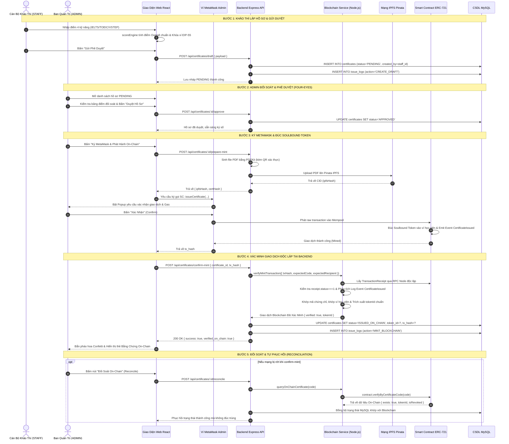

# TÀI LIỆU KIẾN TRÚC & ĐẶC TẢ LUỒNG HOẠT ĐỘNG PHÂN HỆ QUẢN TRỊ (ADMIN PORTAL)
**Hệ Thống Quản Lý & Cấp Phát Chứng Chỉ Tiếng Anh Bằng Blockchain (CertChain)**

> **Phiên bản tài liệu**: 3.0 (Production-Grade & Hardened Architecture)  
> **Cập nhật ngày**: 15/11/2026  
> **Áp dụng tại**: Phân hệ Quản trị CertChain (`/admin/*`) & Backend API (`/api/*`)  
> **Cơ chế bảo vệ**: Nguyên tắc Bốn Mắt (Four-Eyes Principle), Xác minh Blockchain Độc lập (Backend Verification), Đối soát Idempotent (Reconciliation Engine), và Bảo mật Dữ liệu Riêng tư (Privacy-by-Design).

---

## 📑 MỤC LỤC TỔNG QUAN

1. [Đánh Giá Hiện Trạng & Định Hướng Nâng Cấp Kiến Trúc](#1-đánh-giá-hiện-trạng--định-hướng-nâng-cấp-kiến-trúc)
2. [Cỗ Máy Trạng Thái Chứng Chỉ Chuẩn Sản Phẩm (Production State Machine)](#2-cỗ-máy-trạng-thái-chứng-chỉ-chuẩn-sản-phẩm-production-state-machine)
3. [6 Giai Đoạn Vận Hành Phân Hệ Quản Trị](#3-6-giai-đoạn-vận-hành-phân-hệ-quản-trị)
   - [Giai đoạn 1: Đăng Nhập, Quản Lý Phiên & Bảo Mật Khóa (Auth & Key Management)](#giai-đoạn-1-đăng-nhập-quản-lý-phiên--bảo-mật-khóa-auth--key-management)
   - [Giai đoạn 2: Giám Sát Dashboard, Cảnh Báo Nghiệp Vụ & Sức Khỏe Web3](#giai-đoạn-2-giám-sát-dashboard-cảnh-báo-nghiệp-vụ--sức-khỏe-web3)
   - [Giai đoạn 3: Quản Trị Dữ Liệu Nguồn, Hồ Sơ & Phiên Bản Quy Tắc Điểm](#giai-đoạn-3-quản-trị-dữ-liệu-nguồn-hồ-sơ--phiên-bản-quy-tắc-điểm)
   - [Giai đoạn 4: Lập Hồ Sơ & Kiểm Soát Hai Bước (Four-Eyes Approval Workflow)](#giai-đoạn-4-lập-hồ-sơ--kiểm-soát-hai-bước-four-eyes-approval-workflow)
   - [Giai đoạn 5: Xác Minh Giao Dịch Độc Lập & Đúc Soulbound Token On-Chain](#giai-đoạn-5-xác-minh-giao-dịch-độc-lập--đúc-soulbound-token-on-chain)
   - [Giai đoạn 6: Giám Sát Vòng Đời, Thu Hồi, Cấp Lại & Đối Soát Dữ Liệu](#giai-đoạn-6-giám-sát-vòng-đời-thu-hồi-cấp-lại--đối-soát-dữ-liệu)
4. [Mô Hình Mã Băm Mật Mã & Bảo Vệ Quyền Riêng Tư (Privacy-by-Design)](#4-mô-hình-mã-băm-mật-mã--bảo-vệ-quyền-riêng-tư-privacy-by-design)
5. [Cơ Chế Đối Soát & Tự Khôi Phục (Reconciliation & Idempotency)](#5-cơ-chế-đối-soát--tự-khôi-phục-reconciliation--idempotency)
6. [Sơ Đồ Tuần Tự Kiểm Chứng Hai Chiều (Master Sequence Diagram)](#6-sơ-đồ-tuần-tự-kiểm-chứng-hai-chiều-master-sequence-diagram)
7. [Bảng Xử Lý Sự Cố & Hướng Dẫn Vận Hành Hệ Thống (Ops Manual)](#7-bảng-xử-lý-sự-cố--hướng-dẫn-vận-hành-hệ-thống-ops-manual)

---

## 1. ĐÁNH GIÁ HIỆN TRẠNG & ĐỊNH HƯỚNG NÂNG CẤP KIẾN TRÚC

Qua đợt thẩm định bảo mật và kiến trúc hệ thống, hệ thống CertChain xác lập **7 cải tiến trọng yếu** nhằm chuyển đổi từ mô hình thử nghiệm sang chuẩn vận hành thương mại:

| STT | Vấn đề Kiến trúc Cũ | Mức độ | Giải pháp Nâng cấp Phiên bản 3.0 |
| :---: | :--- | :---: | :--- |
| **1** | Admin vừa tạo vừa duyệt nháp, thiếu kiểm soát chéo | **Cao** | Thiết lập **Quy tắc Bốn Mắt (Four-Eyes Principle)**: `STAFF` lập hồ sơ $\to$ `ADMIN` đối soát và phê duyệt. Nếu Admin tự tạo nháp, hệ thống kích hoạt cơ chế ghi vết kiểm toán tăng cường và khóa quyền tự duyệt. Bổ sung trạng thái `REJECTED` khi từ chối hồ sơ. |
| **2** | Backend tin tưởng dữ liệu `tx_hash` do Frontend gửi | **Rất cao** | Triển khai **Xác minh Giao dịch Độc lập tại Backend (`blockchainService.js`)**: Backend tự truy vấn RPC Node, kiểm tra Transaction Receipt (`status === 1`), khớp địa chỉ Smart Contract, bóc tách Event `CertificateIssued`, đối chiếu ví nhận và mã bằng trước khi cập nhật MySQL. |
| **3** | Không có đối soát khi giao dịch thành công nhưng MySQL đứt kết nối | **Rất cao** | Xây dựng **Động cơ Đối soát (Reconciliation Engine - `reconcileCertificate`)**: Kiểm tra định kỳ hoặc cho phép bấm "Đối soát On-Chain" để đọc trực tiếp trạng thái từ Smart Contract, tự động phục hồi dữ liệu MySQL bị lệch mà không bao giờ đúc trùng token. |
| **4** | Dữ liệu cá nhân (CCCD, Họ tên, Điểm số) có nguy cơ lộ trên chuỗi | **Rất cao** | Áp dụng **Privacy-by-Design**: Bỏ số CCCD/CMND khỏi Blockchain; phân tách rõ ràng 3 lớp băm: Mã băm cam kết dữ liệu (`certHash` - Keccak256), Mã băm toàn vẹn tệp PDF (`pdfHash` - SHA-256), và CID IPFS lưu trữ phân tán. |
| **5** | Chưa có quy trình xử lý sai sót & cấp lại chứng chỉ | **Cao** | Xây dựng **Quy trình Cấp Lại Chứng Chỉ (Re-issuance Workflow)**: Tuyệt đối không sửa dữ liệu đã đúc. Tiến hành Thu hồi (`REVOKED`) chứng chỉ sai sót kèm lý do hành chính $\to$ Lập hồ sơ mới liên kết trường `replaces_certificate_id` để duy trì lịch sử truy vết pháp lý. |
| **6** | Dashboard phụ thuộc MetaMask, thiếu cảnh báo hành động | **Trung bình** | Tách biệt việc đọc trạng thái mạng (qua Read-only RPC Provider) với yêu cầu quyền truy cập ví cá nhân. Bổ sung mục **"Công việc cần xử lý" (Action Items)**: Hồ sơ chờ duyệt, Giao dịch lỗi, Lệch đồng bộ. |
| **7** | JWT 24h lưu LocalStorage & Ví cố định mã nguồn | **Cao** | Đề xuất cơ chế Refresh Token an toàn, Cookie `HttpOnly/SameSite`. Môi trường triển khai tách biệt ví Deployer với ví Cấp bằng (`ISSUER_ROLE`) chuyên dụng. |

---

## 2. CỖ MÁY TRẠNG THÁI CHỨNG CHỈ CHUẨN SẢN PHẨM (PRODUCTION STATE MACHINE)

Khắc phục triệt để tình trạng gộp lỗi hoặc lưu trạng thái tạm bợ trên bộ nhớ trình duyệt, CertChain v3.0 quản lý vòng đời chứng chỉ bằng **10 trạng thái chuẩn hóa**, được lưu trữ nhất quán giữa cơ sở dữ liệu MySQL và sổ cái Blockchain:

```
[Khảo Thí Nhập Liệu]
         │
         ▼
     ┌───────┐
     │ DRAFT │ (Đang soạn thảo trên Client & CSDL bản nháp sơ bộ)
     └───────┘
         │
         │ STAFF Gửi phê duyệt
         ▼
    ┌─────────┐                Admin Từ chối               ┌──────────┐
    │ PENDING │ ─────────────────────────────────────────> │ REJECTED │ (Kèm lý do từ chối)
    └─────────┘                                            └──────────┘
         │
         │ Admin Đối soát & Chấp thuận
         ▼
    ┌──────────┐
    │ APPROVED │ (Hồ sơ đã khóa, sẵn sàng ký số)
    └──────────┘
         │
         │ Backend sinh PDF & Upload IPFS
         ▼
   ┌───────────┐
   │ PREPARING │ ─── Lỗi IPFS/Timeout ───> [Tự động lưu lỗi & Cho phép thử lại]
   └───────────┘
         │
         │ Lấy được CID & Metadata
         ▼
┌────────────────────┐
│ AWAITING_SIGNATURE │ (Chờ Admin ký xác nhận trên ví Web3)
└────────────────────┘
         │
         │ Admin Ký ví MetaMask
         ▼
  ┌────────────┐
  │ PROCESSING │ ─── Revert / Hết Gas ───> [Ghi nhận FAILED & Lưu vết Mempool]
  └────────────┘
         │
         │ Transaction Mined & Backend Xác minh Event độc lập
         ▼
┌──────────────────┐
│ ISSUED_ON_CHAIN  │ (Chứng chỉ có hiệu lực pháp lý toàn cầu)
└──────────────────┘
    │          │
    │          │ Quá hạn 2 năm (IELTS, TOEIC, VSTEP)
    │          ▼
    │     ┌─────────┐
    │     │ EXPIRED │ (Hết hạn nghiệp vụ - Quét QR báo hết hạn)
    │     └─────────┘
    │
    │ Phát hiện gian lận / Sai sót hành chính nghiêm trọng
    │ Admin Ký MetaMask gọi hàm revokeCertificate
    ▼
┌─────────┐
│ REVOKED │ (Trạng thái kết thúc - Bất biến vĩnh viễn trên Blockchain)
└─────────┘
```

### Bảng Đặc Tả Chi Tiết 10 Trạng Thái

| Mã Trạng Thái | Ý Nghĩa Nghiệp Vụ | Nơi Lưu Trữ | Điều Kiện Chuyển Tiếp Hợp Lệ |
| :--- | :--- | :--- | :--- |
| **`DRAFT`** | Hồ sơ đang soạn, chưa hoàn chỉnh điểm 4 kỹ năng | MySQL (`certificates`) | Staff đang nhập liệu hoặc lưu tạm. |
| **`PENDING`** | Đã hoàn tất điểm, gửi lên Ban Giám Hiệu chờ duyệt | MySQL & `issue_logs` | Điểm số hợp lệ theo `scoreEngine`, ví học viên đúng EIP-55. |
| **`REJECTED`** | Admin từ chối bản nháp (sai điểm, sai tên) | MySQL & `issue_logs` | Admin bắt buộc nhập lý do từ chối; hồ sơ chuyển về Staff sửa lại. |
| **`APPROVED`** | Đã được duyệt, hồ sơ bị khóa đóng băng dữ liệu | MySQL | Admin chấp thuận; không ai được sửa điểm nữa. |
| **`PREPARING`** | Backend đang tạo tệp PDF vector & đẩy lên Pinata IPFS | Backend Process | Tự động kích hoạt khi bước vào tiến trình phát hành. |
| **`AWAITING_SIGNATURE`**| CID và hàm băm đã sẵn sàng, chờ Admin ký MetaMask | Backend & UI Modal | Admin mở popup xác nhận giao dịch trên trình duyệt. |
| **`PROCESSING`** | Giao dịch đang nằm trong khối đào (Mining) | Blockchain Mempool | Admin đã gửi raw transaction; hệ thống chờ Receipt. |
| **`ISSUED_ON_CHAIN`** | Soulbound Token đã đúc; Backend đã xác minh Event | Smart Contract & MySQL | Transaction thành công (`receipt.status === 1`), phát sinh `CertificateIssued`. |
| **`EXPIRED`** | Chứng chỉ đã quá thời hạn 2 năm theo quy chế thi | Tính toán thời gian thực | `block.timestamp > expiryDate` (Áp dụng IELTS/TOEIC/VSTEP). |
| **`REVOKED`** | Chứng chỉ bị hủy bỏ giá trị pháp lý vĩnh viễn | Smart Contract & MySQL | **Duy nhất Admin ký giao dịch `revokeCertificate` On-Chain**. |

---

## 3. 6 GIAI ĐOẠN VẬN HÀNH PHÂN HỆ QUẢN TRỊ

---

### GIAI ĐOẠN 1: ĐĂNG NHẬP, QUẢN LÝ PHIÊN & BẢO MẬT KHÓA (AUTH & KEY MANAGEMENT)

#### 1. Mục tiêu kiến trúc
Đảm bảo định danh chính xác cán bộ, chống tấn công XSS/CSRF, kiểm soát phiên làm việc nghiêm ngặt và bảo vệ Private Key của tổ chức phát hành.

#### 2. Luồng vận hành chi tiết
1. **Đăng nhập & Cấp phát phiên**:
   * Cán bộ truy cập `/login`. Nhập Tên đăng nhập và Mật khẩu.
   * Backend xác thực mật khẩu băm BCrypt. Kiểm tra trạng thái tài khoản `status = 'ACTIVE'`.
   * **Cơ chế Token an toàn**:
     * `Access Token`: Thời hạn ngắn (15 - 30 phút), dùng để gọi các API nghiệp vụ thông thường.
     * `Refresh Token`: Thời hạn 7 ngày, lưu dưới dạng Cookie `HttpOnly`, cờ `Secure`, `SameSite=Strict` để chống đọc trộm qua mã độc JavaScript (XSS).
2. **Kiểm tra trạng thái thời gian thực**:
   * Tại mỗi request có gắn token, middleware `authMiddleware.js` không chỉ giải mã JWT mà còn truy vấn nhẹ bộ nhớ cache/CSDL để kiểm tra tài khoản có bị khóa (`LOCKED`) hoặc bị hạ quyền (`ROLE_CHANGED`) hay không. Nếu có, lập tức thu hồi phiên làm việc.
3. **Quản trị Khóa Ký Phát Hành (Issuer Key Management)**:
   * **Không bao giờ lưu Private Key trong mã nguồn Frontend hoặc CSDL ứng dụng**.
   * Trên môi trường Production: Tách biệt địa chỉ Deployer hợp đồng với địa chỉ Issuer. Quản trị viên ký giao dịch thông qua ví phần cứng (Ledger / Trezor) hoặc ví bảo mật Web3 (MetaMask) kết nối với mạng Mainnet/L2.

---

### GIAI ĐOẠN 2: GIÁM SÁT DASHBOARD, CẢNH BÁO NGHIỆP VỤ & SỨC KHỎE WEB3

#### 1. Mục tiêu kiến trúc
Cung cấp màn hình điều hành trực quan, tách bạch giữa việc đọc dữ liệu công khai và kết nối ví cá nhân, tập trung vào các **Hành động nghiệp vụ cần xử lý ngay**.

#### 2. Phân vùng chức năng trên Dashboard
* **Vùng 1: Bộ Đo Sức Khỏe Mạng Web3 (Read-Only RPC Health)**:
  * Kết nối tới Smart Contract thông qua nhà cung cấp RPC công khai (`ethers.JsonRpcProvider`).
  * Hiển thị: Mạng Blockchain đang kết nối, Địa chỉ Smart Contract, Block cao nhất hiện tại, Trạng thái hoạt động của IPFS Gateway.
  * **Không ép buộc Admin phải bật popup kết nối ví cá nhân chỉ để xem thống kê**. Chỉ yêu cầu kết nối ví khi Admin thực hiện tác vụ ký phát hành hoặc thu hồi.
* **Vùng 2: Khu Vực Công Việc Cần Xử Lý (Action Required Area)**:
  * 🔔 **Hồ sơ chờ phê duyệt**: Danh sách các chứng chỉ do Staff gửi lên ở trạng thái `PENDING`.
  * ⚠️ **Giao dịch Blockchain lỗi / Cần đối soát**: Các chứng chỉ đã gửi lệnh nhưng chưa nhận được biên lai hoặc bị lệch trạng thái giữa MySQL và Blockchain.
  * ⏳ **Chứng chỉ sắp hết hạn**: Các văn bằng IELTS/TOEIC/VSTEP sắp cán mốc 2 năm kể từ ngày cấp.
* **Vùng 3: Thống Kê Tổng Quan & Biểu Đồ**:
  * Các khối Counter thời gian thực: Tổng số chứng chỉ, Đang hiệu lực (`ISSUED_ON_CHAIN`), Đã từ chối (`REJECTED`), Đã thu hồi (`REVOKED`).
  * Biểu đồ tỷ lệ phân bố giữa các kỳ thi (IELTS, TOEIC, VSTEP, Cambridge, TOEFL).
  * Nhật ký kiểm toán 10 thao tác quản trị gần nhất trích xuất từ bảng `issue_logs`.

---

### GIAI ĐOẠN 3: QUẢN TRỊ DỮ LIỆU NGUỒN, HỒ SƠ & PHIÊN BẢN QUY TẮC ĐIỂM

#### 1. Mục tiêu kiến trúc
Quản lý tập trung thông tin học viên, danh mục kỳ thi và lưu trữ phiên bản quy tắc tính điểm nhằm đảm bảo tính giải trình pháp lý lâu dài.

#### 2. Nguyên tắc quản trị dữ liệu
1. **Kiểm tra trùng lặp hồ sơ học viên**:
   * Kiểm tra nghiêm ngặt tính duy nhất của Mã học viên (`student_code`), Số định danh công dân (`citizen_id`) và Email.
   * **Bảo vệ quyền riêng tư**: Số CCCD/CMND chỉ lưu nội bộ trong MySQL có mã hóa, **tuyệt đối không đưa lên Blockchain công khai**.
2. **Quy định về Địa chỉ ví học viên (EIP-55 Checksum)**:
   * Địa chỉ ví được chuẩn hóa qua hàm `ethers.getAddress(address.toLowerCase())`.
   * **Quy tắc bất biến ví**: Khi một chứng chỉ đã được đúc Soulbound Token vào một địa chỉ ví cụ thể, địa chỉ ví gắn với chứng chỉ đó sẽ **bị khóa vĩnh viễn**. Nếu học viên thay đổi ví trong hồ sơ cá nhân sau này, chứng chỉ cũ vẫn giữ nguyên địa chỉ ví gốc trên chuỗi khối để đảm bảo tính toàn vẹn lịch sử.
3. **Quản lý Phiên Bản Quy Tắc Điểm (Scoring Rule Versioning)**:
   * Mỗi chứng chỉ phát hành đều ghi nhận cấu hình thang điểm và công thức làm tròn tại đúng thời điểm thi.
   * Khi trung tâm cập nhật quy chế điểm mới (ví dụ: đổi cách làm tròn điểm TOEIC hay đổi khung VSTEP), quy chế mới chỉ áp dụng cho các khóa thi tương lai, **không bao giờ áp dụng ngược làm thay đổi kết quả các chứng chỉ đã phát hành**.

---

### GIAI ĐOẠN 4: LẬP HỒ SƠ & KIỂM SOÁT HAI BƯỚC (FOUR-EYES APPROVAL WORKFLOW)

#### 1. Mục tiêu kiến trúc
Xóa bỏ hoàn toàn rủi ro thao túng điểm số hoặc gian lận đúc bằng thông qua quy trình kiểm soát chéo độc lập giữa Cán bộ Khảo thí và Ban Quản Trị.

```
       BƯỚC 1: LẬP HỒ SƠ                                  BƯỚC 2: PHÊ DUYỆT
[ Cán bộ Khảo thí (STAFF) ]                          [ Ban Giám Hiệu (ADMIN) ]
             │                                                   │
             ▼                                                   ▼
┌─────────────────────────┐                             ┌─────────────────────────┐
│ 1. Chọn học viên nguồn  │                             │ 1. Mở danh sách PENDING │
│ 2. Nhập điểm 4 kỹ năng  │                             │ 2. Đối chiếu bảng điểm  │
│ 3. scoreEngine tính điểm│ ──── Gửi phê duyệt ───────> │ 3. Kiểm tra thông tin   │
│ 4. Kiểm tra Live Preview│       (PENDING)             │ 4. Ra quyết định:       │
│ 5. Bấm "Gửi Phê Duyệt"  │                             │    - CHẤP THUẬN (Duyệt) │
└─────────────────────────┘                             │    - TỪ CHỐI (Ghi lý do)│
                                                        └─────────────────────────┘
```

#### 2. Quy trình chi tiết từng bước
1. **Bước 4.1: Khảo thí lập hồ sơ (Staff Entry)**:
   * Staff chọn học viên từ cơ sở dữ liệu.
   * Nhập điểm các kỹ năng: Động cơ `scoreEngine.js` tự động tính điểm Overall theo quy chế thi quốc tế và tự động tính hạn hiệu lực 2 năm.
   * Staff kiểm tra phôi bằng hiển thị trực quan bên cột Live Preview.
   * Staff bấm **"Lưu Bản Nháp (Gửi Ban Giám Hiệu Duyệt)"**. Hệ thống ghi bản ghi vào MySQL với trạng thái `PENDING`, ghi nhận `created_by = staff_id`.
   * **Khóa dữ liệu**: Hồ sơ ở trạng thái `PENDING` bị khóa chỉnh sửa đối với Staff.
2. **Bước 4.2: Ban Giám Hiệu đối soát & phê duyệt (Admin Approval)**:
   * Admin mở danh sách chứng chỉ chờ duyệt.
   * Admin bấm xem chi tiết hồ sơ: Màn hình hiển thị bảng đối soát bao gồm bảng điểm gốc, thông tin định danh học viên, ví nhận và phôi dự thảo.
   * **Trường hợp Từ chối (`REJECT`)**: Admin bấm "Từ chối hồ sơ", bắt buộc nhập lý do từ chối (ví dụ: *"Sai điểm Listening so với bài thi gốc"*). Trạng thái chuyển thành `REJECTED`. Hệ thống gửi thông báo trả về cho Staff lập lại.
   * **Trường hợp Chấp thuận (`APPROVE`)**: Admin bấm "Phê Duyệt & Chuyển Sang Ký On-Chain". Trạng thái chuyển sang `APPROVED`. Hồ sơ sẵn sàng cho giai đoạn đúc Blockchain.
   * **Cơ chế Kiểm soát Tự Duyệt**: Nếu một bản ghi do chính Admin tạo ra, hệ thống yêu cầu một Admin thứ hai xác nhận hoặc hiển thị cảnh báo kiểm toán độc lập trên nhật ký `issue_logs`.

---

### GIAI ĐOẠN 5: XÁC MINH GIAO DỊCH ĐỘC LẬP & ĐÚC SOULBOUND TOKEN ON-CHAIN

#### 1. Mục tiêu kiến trúc
Thực hiện đúc tài sản số Soulbound Token (ERC-721 Non-Transferable) lên Blockchain, lưu trữ phôi bất biến trên IPFS Pinata, và **bắt buộc Backend phải tự xác minh giao dịch độc lập từ RPC Node trước khi chấp nhận ghi nhận dữ liệu**.

#### 2. Luồng thực thi chi tiết
1. **Chuẩn bị dữ liệu & Tạo Metadata IPFS (`PREPARING`)**:
   * Admin bấm **"Ký MetaMask & Phát Hành On-Chain"**.
   * Backend gọi thư viện `PDFKit` sinh file chứng chỉ PDF vector chuẩn in ấn, tích hợp chữ ký số và mã QR xác thực.
   * Backend đẩy tệp PDF lên mạng IPFS thông qua dịch vụ Pinata, nhận về mã CID định danh phân tán.
   * Tính toán mã băm Keccak-256 dữ liệu chuẩn hóa (`certHash`) và mã băm toàn vẹn tệp PDF (`pdfHash`).
2. **Ký giao dịch qua ví MetaMask (`AWAITING_SIGNATURE` $\to$ `PROCESSING`)**:
   * Màn hình mở cửa sổ tổng hợp thông tin xác nhận lần cuối: Họ tên học viên, Mã bằng, Điểm thi, Địa chỉ ví nhận, CID IPFS.
   * Khởi tạo hàm Smart Contract thông qua ví Admin:
     ```solidity
     contract.issueCertificate(
         recipientAddress,
         certificateCode,
         studentName,
         studentCode,
         courseCode,
         courseName,
         score,
         expiryTimestamp,
         ipfsHash,
         certHash,
         tokenURI
     );
     ```
   * Admin xác nhận chữ ký trên popup MetaMask. Giao dịch được phát thanh vào mạng lưới Blockchain.
3. **Xác minh giao dịch độc lập tại Backend (Backend Blockchain Verification)**:
   * Client nhận được Transaction Hash (`tx_hash`) từ MetaMask và gửi request về: `POST /api/certificates/confirm-mint`.
   * **Backend KHÔNG tin tưởng mù quáng tham số của Client**. Backend kích hoạt dịch vụ `blockchainService.js`:
     ```javascript
     // 1. Kiểm tra mã băm txHash
     const receipt = await provider.getTransactionReceipt(tx_hash);
     
     // 2. Xác minh giao dịch thành công (Không bị Revert)
     if (!receipt || receipt.status !== 1) throw new Error("Giao dịch Blockchain thất bại");
     
     // 3. Khớp địa chỉ Smart Contract đích
     if (receipt.to.toLowerCase() !== CONTRACT_ADDRESS) throw new Error("Sai hợp đồng chứng chỉ");
     
     // 4. Bóc tách Event CertificateIssued trong Transaction Logs
     const event = parseCertificateIssuedEvent(receipt.logs);
     
     // 5. Đối chiếu mã bằng và ví nhận on-chain với CSDL nội bộ
     if (event.certificateCode !== cert.certificate_code) throw new Error("Sai lệch mã chứng chỉ");
     if (event.recipient.toLowerCase() !== cert.student_wallet.toLowerCase()) throw new Error("Sai ví nhận");
     
     // 6. Lấy chính xác Token ID thực tế từ Event On-Chain
     const verifiedTokenId = event.tokenId.toString();
     ```
4. **Cập nhật CSDL & Ghi vết kiểm toán**:
   * Cập nhật bản ghi trong MySQL: `status = 'ISSUED_ON_CHAIN'`, `token_id = verifiedTokenId`, `tx_hash = receipt.hash`.
   * Ghi nhận một dòng nhật ký kiểm toán `MINT_BLOCKCHAIN` vào `issue_logs` kèm định danh Admin ký và số Block đào.
   * Client hiển thị hiệu ứng chúc mừng Confetti và xuất thẻ bằng chứng Blockchain.

---

### GIAI ĐOẠN 6: GIÁM SÁT VÒNG ĐỜI, THU HỒI, CẤP LẠI & ĐỐI SOÁT DỮ LIỆU

#### 1. Mục tiêu kiến trúc
Quản trị toàn diện vòng đời văn bằng sau phát hành: Tra cứu đa chiều, đối soát khôi phục sự cố, xử lý hết hạn tự nhiên, thu hồi chống chối bỏ và quy trình cấp lại chứng chỉ đúng luật.

#### 2. Các quy trình vận hành chính
1. **Tra cứu & Bộ lọc Đa Tiêu Chí**:
   * Bảng danh sách tại `/admin/certificates` cung cấp bộ lọc kết hợp: Loại chứng chỉ, Trạng thái (Pending, Approved, Issued, Revoked, Expired), Kỳ thi, Khoảng ngày cấp.
   * Xem trước phôi PDF vector sắc nét trực tiếp trong popup Iframe mà không cần tải về máy.
2. **Quy Trình Thu Hồi On-Chain Chống Chối Bỏ (Revocation Workflow)**:
   * Chỉ áp dụng khi phát hiện gian lận quy chế thi hoặc sai lệch nghiêm trọng.
   * **Bảo vệ quyền riêng tư trên chuỗi**: Trên Smart Contract, chỉ ghi nhận mã định danh lý do hành chính (ví dụ: `REV_EXAM_FRAUD_01`). Biên bản chi tiết, hồ sơ hội đồng kỷ luật và bằng chứng vi phạm được lưu trữ bảo mật trong cơ sở dữ liệu nội bộ MySQL.
   * Admin bắt buộc kiểm tra checklist 4 bước và nhập lý do $\to$ Ký MetaMask gọi hàm `revokeCertificate(certCode, reason)`.
   * Backend xác minh sự kiện `CertificateRevoked` trên RPC Node $\to$ Cập nhật `status = 'REVOKED'`.
3. **Quy Trình Xử Lý Sai Sót & Cấp Lại Chứng Chỉ (Re-issuance Workflow)**:
   * *Nguyên tắc tối thượng*: **Tuyệt đối không sửa dữ liệu đã đúc trên Blockchain**.
   * Khi phát hiện sai sót do lỗi đánh máy điểm thi hoặc sai tên:
     * **Bước 1**: Thực hiện quy trình Thu hồi chứng chỉ cũ với lý do: *"Thu hồi để điều chỉnh sai sót hành chính theo biên bản số..."*.
     * **Bước 2**: Khảo thí lập hồ sơ chứng chỉ mới với thông tin chính xác.
     * **Bước 3**: Hồ sơ mới được gán trường liên kết: `replaces_certificate_id = [ID_chứng_chỉ_cũ]`.
     * **Bước 4**: Ban Giám Hiệu phê duyệt và đúc Soulbound Token mới.
     * **Kết quả**: Khi tra cứu chứng chỉ mới hoặc cũ, hệ thống đều hiển thị rõ mối liên kết lịch sử thay thế để thanh tra đối soát.
4. **Cơ Chế Hết Hạn Tự Nhiên (`EXPIRED`)**:
   * Các chứng chỉ quốc tế có thời hạn 2 năm (IELTS, TOEIC, VSTEP) không bị đổi trạng thái thành `REVOKED`.
   * Tại cổng tra cứu công khai, Smart Contract và giao diện tự động đối chiếu `block.timestamp > expiryDate` để gắn nhãn màu vàng cảnh báo: **"CHỨNG CHỈ ĐÃ HẾT HẠN HIỆU LỰC THEO QUY CHẾ"**.

---

## 4. MÔ HÌNH MÃ BĂM MẬT MÃ & BẢO VỆ QUYỀN RIÊNG TƯ (PRIVACY-BY-DESIGN)

Hệ thống phân tách rạch ròi 3 giá trị băm với các mục đích mật mã học hoàn toàn khác nhau:

```
┌────────────────────────────────────────────────────────────────────────────────────────┐
│ 1. DATA COMMITMENT HASH (certHash - Keccak-256)                                       │
│ - Mục đích: Lưu trực tiếp trên Smart Contract đại diện cho cam kết dữ liệu gốc.       │
│ - Đầu vào: Chuỗi JSON chuẩn hóa (Canonical JSON) gồm: Mã bằng, Tên, Điểm, Ngày cấp.   │
│ - Đảm bảo: Bất kỳ ai sửa đổi điểm số hay tên học viên sẽ làm sai lệch certHash.      │
└────────────────────────────────────────────────────────────────────────────────────────┘
                                           │
┌────────────────────────────────────────────────────────────────────────────────────────┐
│ 2. DOCUMENT INTEGRITY HASH (pdfHash - SHA-256)                                         │
│ - Mục đích: Đối soát tính toàn vẹn vật lý của tệp tin phôi bằng PDF.                  │
│ - Đầu vào: Dòng byte nhị phân thô của file PDF gốc do PDFKit sinh ra.                 │
│ - Đảm bảo: Nếu bất kỳ ai dùng Acrobat chỉnh sửa nội dung file, SHA-256 sẽ đổi ngay.    │
└────────────────────────────────────────────────────────────────────────────────────────┘
                                           │
┌────────────────────────────────────────────────────────────────────────────────────────┐
│ 3. CONTENT IDENTIFIER (ipfsHash / CIDv0 - IPFS)                                        │
│ - Mục đích: Địa chỉ định danh lưu trữ phi tập trung trên mạng lưới InterPlanetary File. │
│ - Đầu vào: Tệp PDF và Metadata schema ERC-721 được ghim (pinned) qua Pinata Gateway. │
│ - Đảm bảo: Tính sẵn sàng cao, không bị mất mát dữ liệu khi máy chủ web gặp sự cố.      │
└────────────────────────────────────────────────────────────────────────────────────────┘
```

---

## 5. CƠ CHẾ ĐỐI SOÁT & TỰ KHÔI PHỤC (RECONCILIATION & IDEMPOTENCY)

Một trong những rủi ro lớn nhất của ứng dụng Web3 lai (Hybrid DApp) là **Lệch pha trạng thái (State Desynchronization)**: Giao dịch trên Blockchain đã được thợ đào đóng block thành công, nhưng đường truyền mạng giữa trình duyệt và máy chủ Backend bị ngắt khiến CSDL MySQL chưa kịp cập nhật.

### Quy trình Tự Khôi Phục Idempotent (`reconcileCertificate`)
Khi phát hiện một chứng chỉ đã gửi giao dịch nhưng trong bảng quản trị vẫn hiển thị `PENDING` hoặc `PROCESSING`:

1. Admin bấm nút **"Đối Soát On-Chain"** (Reconcile) trên dòng chứng chỉ đó.
2. Backend gửi truy vấn trực tiếp đến Smart Contract qua hàm View:
   ```solidity
   contract.verifyByCertificateCode(certCode);
   ```
3. Nếu Smart Contract trả về `exists == true`:
   * Backend tự động cập nhật bản ghi trong MySQL: `status = 'ISSUED_ON_CHAIN'`, cập nhật đúng `tokenId` trên chuỗi.
   * Ghi nhận một dòng log kiểm toán: `RECONCILE_SUCCESS`.
   * **Tuyệt đối không bao giờ gửi thêm giao dịch đúc mới**, bảo vệ hệ thống không bị phát sinh token trùng lặp và không lãng phí phí gas.

---

## 6. SƠ ĐỒ TUẦN TỰ KIỂM CHỨNG HAI CHIỀU (MASTER SEQUENCE DIAGRAM)

Sơ đồ thể hiện chu trình hoàn chỉnh theo nguyên tắc Bốn Mắt và Xác minh độc lập tại Backend:



---

## 7. BẢNG XỬ LÝ SỰ CỐ & HƯỚNG DẪN VẬN HÀNH HỆ THỐNG (OPS MANUAL)

| Hiện Tượng Sự Cố | Nguyên Nhân Kỹ Thuật | Hành Động Xử Lý Chuẩn Hóa |
| :--- | :--- | :--- |
| **Backend từ chối xác nhận đúc (`confirm-mint`)** | Mã băm `tx_hash` gửi lên không tìm thấy trên RPC Node hoặc giao dịch bị Revert do lỗi quyền/hết gas. | Kiểm tra log Terminal Hardhat. Xác nhận tài khoản ký có vai trò `ISSUER_ROLE`/`Owner`. Nếu mạng bị lag, bấm nút "Đối Soát On-Chain" sau 5-10 giây để kiểm tra lại. |
| **Hồ sơ bị lệch giữa MySQL (`PENDING`) và Blockchain (`ISSUED`)** | Giao dịch MetaMask ký xong nhưng trình duyệt đóng đột ngột trước khi gọi API `confirm-mint`. | **Tuyệt đối không bấm nút đúc lại**. Mở danh sách chứng chỉ, click vào nút biểu tượng làm mới **"Đối Soát On-Chain"**; hệ thống sẽ tự động đọc Smart Contract và kéo trạng thái về `ISSUED_ON_CHAIN`. |
| **Địa chỉ ví học viên báo lỗi checksum** | Chuỗi địa chỉ ví bị dán sai ký tự hoa thường hoặc thiếu độ dài 42 ký tự. | Hệ thống đã tích hợp `ethers.getAddress(addr.toLowerCase())`. Đảm bảo địa chỉ có tiền tố `0x` và đủ 40 ký tự hex theo sau. |
| **Học viên khiếu nại sai tên/sai điểm sau khi đã cấp bằng** | Không thể sửa trực tiếp vì Blockchain có tính bất biến. | Thực hiện quy trình **Cấp Lại (Re-issuance)**: Thu hồi chứng chỉ cũ với lý do hành chính $\to$ Lập hồ sơ mới gắn `replaces_certificate_id` $\to$ Ban Giám Hiệu duyệt và cấp văn bằng mới. |
| **MetaMask cảnh báo sai Chain ID** | Trình duyệt đang ở mạng Ethereum Mainnet hoặc Sepolia thay vì Hardhat Node (31337). | Bấm nút chuyển mạng trên thông báo giao diện để kích hoạt `wallet_switchEthereumChain` chuyển về mạng `Hardhat Localhost` (`http://127.0.0.1:8545`). |

---

> 📌 **Tài liệu đối soát kiến trúc liên quan**:
> - [Tệp Dịch Vụ Xác Minh Blockchain Độc Lập](file:///D:/blockchain/blockchain-english-certificates/backend/src/services/blockchainService.js)
> - [Bộ Điều Khiển Nghiệp Vụ Chứng Chỉ Backend](file:///D:/blockchain/blockchain-english-certificates/backend/src/controllers/certificateController.js)
> - [Mã Nguồn Smart Contract Soulbound Token](file:///D:/blockchain/blockchain-english-certificates/contracts/contracts/EnglishCertificateNFT.sol)
> - [Đặc Tả Động Cơ Chấm Điểm Đa Kỳ Thi](file:///D:/blockchain/blockchain-english-certificates/frontend/src/services/scoreEngine.js)
