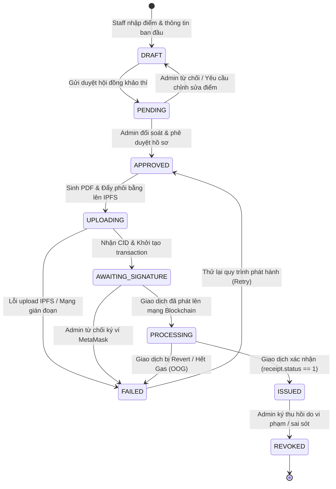
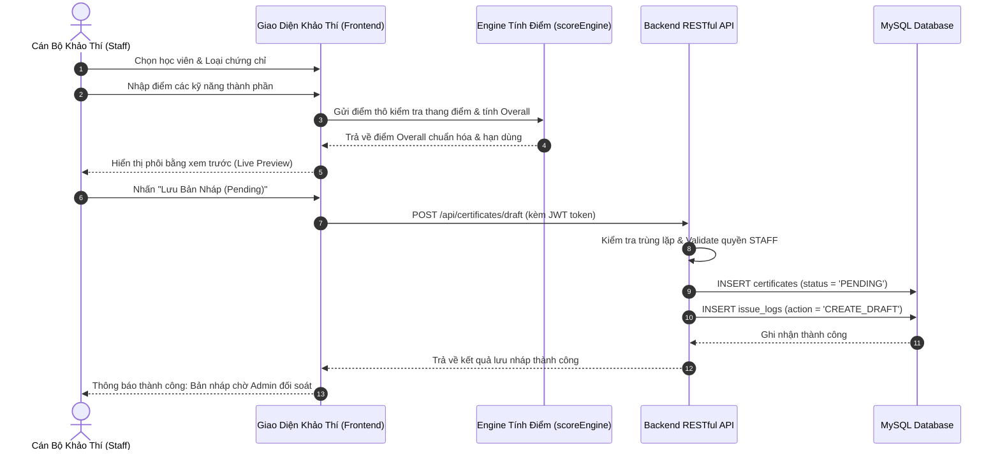
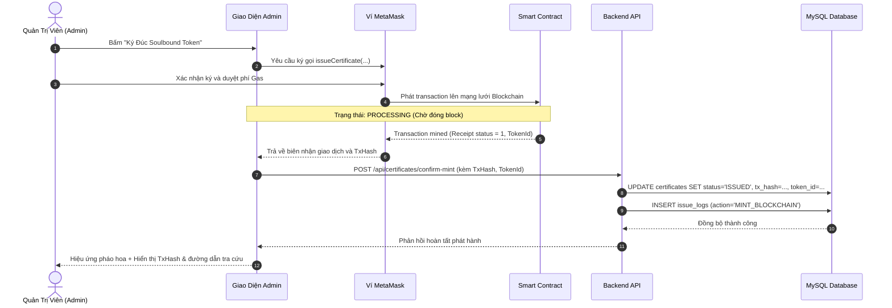
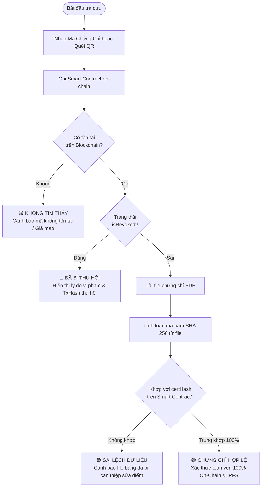

# TÀI LIỆU KIẾN TRÚC & LUỒNG HOẠT ĐỘNG TOÀN DIỆN CỦA HỆ THỐNG (v2.0)
## DỰ ÁN: QUẢN LÝ VÀ XÁC THỰC CHỨNG CHỈ TIẾNG ANH BẰNG BLOCKCHAIN (CERTCHAIN)

---

## 1. TỔNG QUAN HỆ THỐNG & NGUYÊN TẮC THIẾT KẾ (ARCHITECTURE PRINCIPLES)

**CertChain** là hệ thống cấp phát, quản lý và thẩm định chứng chỉ tiếng Anh (IELTS, TOEIC, VSTEP, TOEFL, Cambridge...) ứng dụng công nghệ **Blockchain (Smart Contract)**, mạng lưu trữ phân tán **IPFS (InterPlanetary File System)** và cơ sở dữ liệu quan hệ **MySQL**.

### 1.1. Bốn nguyên tắc kỹ thuật cốt lõi:
1. **Soulbound Token (SBT) & Định danh thực tế:**
   * Chứng chỉ được đúc dưới dạng Token ERC-721 không thể chuyển nhượng (Non-Transferable). Ngăn chặn hành vi sang nhượng, mua bán chứng chỉ trên thị trường thứ cấp.
   * *Lưu ý định danh:* SBT là công cụ khóa quyền chuyển nhượng trên ví Web3; danh tính người sở hữu được đảm bảo thông qua quy trình thẩm định hồ sơ (CCCD/Passport, mã học viên) đã được xác minh trước khi phát hành.
2. **Cơ chế lưu trữ dữ liệu phân tầng (Hybrid Storage Partitioning):**
   * Tách biệt rõ ràng trách nhiệm giữa: **MySQL** (nghiệp vụ, quản trị, nhật ký), **IPFS** (tài liệu phôi bằng PDF và metadata bảo toàn nội dung), **Smart Contract** (bằng chứng bất biến Proof of Existence, cam kết dữ liệu `certHash`, trạng thái hiệu lực on-chain).
3. **Thẩm định tính toàn vẹn kép (Double Integrity Verification):**
   * Không đồng nhất mã băm phân tán CID của IPFS với mã băm dữ liệu gốc.
   * Hệ thống tính toán mã băm SHA-256 trực tiếp từ nội dung chứng chỉ/phôi bằng và ghi nhận vào trường `bytes32 certHash` của Smart Contract. Khi thẩm định, file PDF được tính lại hash để đối soát trực tiếp với dữ liệu trên chuỗi.
4. **Thẩm định công khai không rào cản (Zero-barrier Public Verification):**
   * Bất kỳ bên thứ ba nào (Nhà tuyển dụng, Trường đại học, Đại sứ quán) đều có thể kiểm tra chứng chỉ tức thì qua mã định danh hoặc quét mã QR mà **không cần tạo tài khoản hoặc đăng nhập**. Mã QR chỉ chứa URL xác thực chuẩn hóa, không phơi bày thông tin cá nhân thô.

---

## 2. PHÂN ĐỊNH TRÁCH NHIỆM LƯU TRỮ DỮ LIỆU (DATA PARTITIONING)

Nhằm đảm bảo quyền riêng tư người học (tuân thủ nguyên tắc Privacy by Design) và tối ưu chi phí gas giao dịch Blockchain, hệ thống phân định vị trí lưu trữ dữ liệu như sau:

| Thành phần | Dữ liệu lưu trữ | Mục đích & Đặc tính |
| :--- | :--- | :--- |
| **MySQL Database** | • Hồ sơ chi tiết học viên (CCCD, SĐT, Email, Ngày sinh)<br>• Điểm từng kỹ năng, phân loại kết quả, ngày thi<br>• Trạng thái nghiệp vụ nội bộ (`DRAFT`, `PENDING`, `ISSUED`, `REVOKED`)<br>• Khóa ngoại, Token ID, TxHash, Block Number, CID IPFS<br>• Bảng nhật ký thao tác kiểm toán (`issue_logs`) | Quản lý nghiệp vụ thường nhật, truy vấn nhanh, lưu vết thao tác, bảo mật dữ liệu định danh nội bộ. |
| **Smart Contract (Blockchain)** | • Token ID (duy nhất)<br>• Mã chứng chỉ (`certificateCode`)<br>• Mã băm toàn vẹn tài liệu (`bytes32 certHash`)<br>• Địa chỉ ví học viên (`recipientAddress`)<br>• Tên học viên, Mã khóa học, Tên khóa học, Điểm Overall<br>• Ngày cấp (`issueDate`), Ngày hết hạn (`expiryDate`)<br>• Trạng thái hiệu lực (`isRevoked`, `revokeReason`) | Bằng chứng gốc bất biến (Single Source of Truth), chống sửa đổi gian lận, làm trọng tài xác thực công khai toàn cầu. |
| **IPFS (Pinata Gateway)** | • Phôi file PDF chứng chỉ chuẩn in ấn (đã nhúng QR URL)<br>• File JSON Metadata chuẩn ERC-721 (chỉ chứa thông tin xác minh cơ bản, đã lược bỏ CCCD/SĐT nhạy cảm) | Lưu trữ phân tán, gán địa chỉ theo nội dung (CID), đảm bảo phôi bằng không bị mất khi máy chủ nội bộ gặp sự cố. |
| **Backend & Engine** | • Bộ quy tắc tính điểm đa kỳ thi (`scoreEngine`)<br>• Kiểm tra tính hợp lệ dữ liệu đầu vào & chống trùng lặp<br>• Quản lý phiên JWT, kiểm tra quyền RBAC trước khi vào DB/Chain | Xử lý logic trung gian, bảo vệ cơ sở dữ liệu và ngăn chặn gửi giao dịch sai lên blockchain. |

---

## 3. MÁY TRẠNG THÁI PHÁT HÀNH CHỨNG CHỈ (ISSUANCE STATE MACHINE)

Để khắc phục rủi ro bất đồng bộ giữa IPFS, Blockchain và MySQL (ví dụ: giao dịch blockchain lỗi nhưng file đã lên IPFS, hoặc blockchain đúc thành công nhưng MySQL mất kết nối), hệ thống áp dụng máy trạng thái phát hành nghiêm ngặt:



### Bảng định nghĩa chi tiết các trạng thái:
* **`DRAFT` (Bản phác thảo):** Dữ liệu điểm đang được Cán bộ khảo thí nhập liệu, chưa gửi duyệt.
* **`PENDING` (Chờ duyệt):** Đã hoàn tất nhập điểm và kiểm tra đầu vào, chờ Quản trị viên đối soát.
* **`APPROVED` (Đã duyệt):** Quản trị viên đã chấp thuận điểm số và thông tin người nhận.
* **`UPLOADING` (Đang chuẩn bị dữ liệu):** Đang sinh file PDF, tính mã băm SHA-256 và tải lên IPFS.
* **`AWAITING_SIGNATURE` (Chờ ký):** Dữ liệu đã sẵn sàng trên IPFS, hiển thị popup MetaMask chờ Admin ký.
* **`PROCESSING` (Đang xử lý on-chain):** Giao dịch đã được gửi vào Mempool, đang chờ thợ đào/validator đóng block.
* **`ISSUED` (Đã phát hành thành công):** Giao dịch được xác nhận thành công trên Blockchain (`receipt.status === 1`), đã có Token ID và Block Number.
* **`FAILED` (Thất bại):** Xảy ra lỗi ở bước tải IPFS, từ chối ký ví hoặc giao dịch blockchain bị revert. Cho phép bấm "Thử lại".
* **`REVOKED` (Đã thu hồi):** Chứng chỉ đã bị vô hiệu hóa hiệu lực trên cả Blockchain và cơ sở dữ liệu.

---

## 4. MA TRẬN PHÂN QUYỀN TRUY CẬP (RBAC & SECURITY IN-DEPTH)

Hệ thống thiết lập bảo mật theo chiều sâu: **Giao diện Frontend chỉ đóng vai trò chỉ dẫn người dùng (UX Control), còn Backend JWT/RBAC Middleware và Smart Contract `onlyRole` mới là chốt chặn bảo vệ bắt buộc.**

| Chức Năng Nghiệp Vụ | Cán Bộ Khảo Thí (STAFF) | Quản Trị Viên (ADMIN) | Học Viên (STUDENT) | Nhà Tuyển Dụng & Công Chúng (PUBLIC) |
| :--- | :---: | :---: | :---: | :---: |
| **Nhập điểm & Lưu nháp (`DRAFT`/`PENDING`)** | ✅ Cho phép | ✅ Cho phép | ❌ Bị chặn | ❌ Bị chặn |
| **Chỉnh sửa bản nháp** | ✅ Chỉ khi trạng thái `DRAFT` | ✅ Có lưu log | ❌ Bị chặn | ❌ Bị chặn |
| **Sửa điểm chứng chỉ đã `ISSUED`** | ❌ **Tuyệt đối cấm** | ❌ **Tuyệt đối cấm** *(phải Thu hồi & Cấp lại)* | ❌ Bị chặn | ❌ Bị chặn |
| **Đối soát & Phê duyệt (`APPROVED`)** | ❌ Không có quyền | ✅ Cho phép | ❌ Bị chặn | ❌ Bị chặn |
| **Ký ví MetaMask đúc Soulbound Token** | ❌ Bị chặn ở cả UI & Smart Contract | ✅ Cần ví có `ISSUER_ROLE` | ❌ Bị chặn | ❌ Bị chặn |
| **Ký ví thu hồi chứng chỉ (Revoke)** | ❌ Bị chặn ở cả UI & Smart Contract | ✅ Cần ví có `REVOKER_ROLE` | ❌ Bị chặn | ❌ Bị chặn |
| **Quản lý khóa học (Thêm/Sửa danh mục)** | ❌ Bị ẩn nút & Chặn API | ✅ Toàn quyền | ❌ Bị chặn | ❌ Bị chặn |
| **Xem chứng chỉ cá nhân** | ❌ | ❌ | ✅ Chỉ xem bằng của mình | ❌ |
| **Tra cứu công khai & Quét mã QR** | ✅ Truy cập | ✅ Truy cập | ✅ Truy cập | ✅ **Tự do, không cần đăng nhập** |

---

## 5. BỘ ENGINE TÍNH ĐIỂM VÀ XÁC ĐỊNH HIỆU LỰC THEO TỪNG CHỨNG CHỈ

Thay vì áp dụng công thức chung, CertChain xây dựng **Engine tính điểm độc lập (`scoreEngine`)** theo cấu hình kỳ thi:

### 5.1. Bảng quy tắc tính điểm:
1. **IELTS (Academic / General Training):**
   * *Đầu vào:* 4 kỹ năng Listening, Reading, Writing, Speaking (thang điểm 0.0 - 9.0, bước nhảy 0.5).
   * *Công thức Overall:* Trung bình cộng 4 kỹ năng = `(L + R + W + S) / 4`.
   * *Quy tắc làm tròn chuẩn quốc tế:*
     * Phần lẻ `< 0.25` ➔ làm tròn xuống `.0` (VD: 6.125 ➔ 6.0).
     * Phần lẻ `>= 0.25` và `< 0.75` ➔ làm tròn thành `.5` (VD: 6.25 ➔ 6.5, 6.625 ➔ 6.5).
     * Phần lẻ `>= 0.75` ➔ làm tròn lên bậc nguyên kế tiếp (VD: 6.75 ➔ 7.0).
2. **TOEIC Listening & Reading (2 kỹ năng):**
   * *Đầu vào:* Listening (5 - 495) và Reading (5 - 495), bước nhảy 5 điểm.
   * *Công thức Overall:* Tổng 2 kỹ năng = `L + R` (thang 10 - 990).
3. **TOEIC Speaking & Writing (2 kỹ năng):**
   * *Đầu vào:* Speaking (0 - 200) và Writing (0 - 200), bước nhảy 10 điểm.
   * *Công thức Overall:* Tổng 2 kỹ năng = `S + W` (thang 0 - 400).
4. **VSTEP (Khung năng lực ngoại ngữ 6 bậc Việt Nam):**
   * *Đầu vào:* 4 kỹ năng (mỗi kỹ năng từ 0.0 đến 10.0, bước nhảy 0.5).
   * *Công thức Overall:* Trung bình cộng 4 kỹ năng, làm tròn đến 0.5.
   * *Quy đổi bậc:* `< 4.0`: Không xét; `4.0 - 5.5`: Bậc 3 (B1); `6.0 - 8.0`: Bậc 4 (B2); `8.5 - 10.0`: Bậc 5 (C1).
5. **Cambridge English (B2 First, C1 Advanced, C2 Proficiency):**
   * *Đầu vào:* Điểm Cambridge English Scale (80 - 230) cho từng kỹ năng.
   * *Công thức Overall:* Trung bình cộng các bài thi con.
6. **TOEFL iBT:**
   * *Đầu vào:* 4 kỹ năng Reading, Listening, Speaking, Writing (mỗi kỹ năng 0 - 30).
   * *Công thức Overall:* Tổng 4 kỹ năng = `R + L + S + W` (thang 0 - 120).

### 5.2. Nguyên tắc xác định thời hạn hiệu lực:
* Phân định rõ 3 trường thông tin: **Ngày thi (`exam_date`)**, **Ngày cấp (`issue_date`)**, và **Ngày hết hạn (`expiry_date`)**.
* Không tự động gán mặc định 2 năm cho tất cả văn bằng:
  * Khóa học có quy định thời hạn (như IELTS, TOEIC theo khuyến nghị đơn vị tiếp nhận): Lấy số tháng cấu hình trong bảng `courses` (ví dụ: 24 tháng).
  * Khóa học có giá trị vĩnh viễn (như Cambridge C1/C2 hoặc một số văn bằng nghề): `expiry_date` được đặt bằng `NULL` (hoặc `0` trên Smart Contract = Không thời hạn).
* Trạng thái chứng chỉ trên Blockchain:
  * `ACTIVE`: Đã phát hành, chưa bị thu hồi, chưa vượt quá ngày hết hạn (nếu có).
  * `EXPIRED`: Đã vượt quá `expiryDate` (nhưng thông tin cấp phát vẫn được chứng thực là thật trong quá khứ).
  * `REVOKED`: Đã bị hủy bỏ tính hiệu lực do gian lận hoặc sai sót.

---

## 6. QUY TRÌNH 7 BƯỚC HOẠT ĐỘNG TOÀN DIỆN CỦA HỆ THỐNG

### BƯỚC 1: TIẾP NHẬN VÀ QUẢN LÝ KẾT QUẢ THI (KHẢO THÍ & TẠO BẢN NHÁP)
* **Tác nhân:** Cán bộ khảo thí (`STAFF`) hoặc Quản trị viên (`ADMIN`).
* **Quy trình chi tiết:**
  1. Cán bộ đăng nhập vào trang Cấp Chứng Chỉ (`/admin/certificates/issue`).
  2. Chọn mã học viên từ danh sách đã được xác minh danh tính (KYC). Hệ thống tự điền họ tên, số CCCD và địa chỉ ví Web3 của học viên.
  3. Chọn khóa học/kỳ thi. Giao diện tự động thích ứng các ô nhập điểm kỹ năng theo cấu hình của kỳ thi đó (IELTS, TOEIC hay VSTEP).
  4. Hệ thống kiểm tra tính hợp lệ dữ liệu đầu vào:
     * Điểm từng kỹ năng phải nằm trong khoảng cho phép của thang điểm.
     * Kiểm tra trùng lặp: Học viên không thể có 2 chứng chỉ cùng một mã khóa học trong cùng một ngày thi.
  5. `scoreEngine` tự động tính điểm Overall và tính ngày hết hạn tương ứng.
  6. Giao diện hiển thị phôi bằng xem trước thời gian thực (Live Preview).
  7. Nhấn **"Lưu Bản Nháp"**: Dữ liệu được ghi vào MySQL với trạng thái `PENDING`. Lưu vết người tạo vào `issue_logs`.



---

### BƯỚC 2: KIỂM TRA VÀ PHÊ DUYỆT (ADMIN PRE-SIGN CHECKLIST)
* **Tác nhân:** Quản trị viên / Giám đốc trung tâm (`ADMIN`).
* **Mục đích:** Rà soát sai sót hồ sơ trước khi đưa dữ liệu bất biến lên Blockchain.
* **Quy trình chi tiết:**
  1. Admin mở danh sách chứng chỉ (`/admin/certificates`), lọc các bản ghi `PENDING`.
  2. Bấm nút **"Xem Chi Tiết & Phê Duyệt"**: Hệ thống hiển thị Modal đối chiếu đầy đủ gồm:
     * Họ tên, ngày sinh, số CCCD học viên.
     * Địa chỉ ví nhận chứng chỉ (bắt buộc khớp với ví học viên).
     * Điểm từng kỹ năng, điểm tổng, ngày thi, đơn vị tổ chức.
     * File PDF xem trước.
  3. Nếu phát hiện sai sót điểm số: Admin nhập phản hồi và bấm "Trả về chỉnh sửa" ➔ Chuyển trạng thái về `DRAFT` để Staff nhập lại.
  4. Nếu thông tin chuẩn xác: Admin bấm **"Phê Duyệt Phát Hành"** ➔ Chuyển trạng thái sang `APPROVED`.

---

### BƯỚC 3: CHUẨN BỊ DỮ LIỆU PHÁT HÀNH (DATA COMMITMENT & IPFS PINNING)
* **Tác nhân:** Hệ thống Backend tự động thực thi sau khi nhận lệnh phát hành từ Admin.
* **Quy trình chi tiết:**
  1. Hệ thống chuyển trạng thái sang `UPLOADING`.
  2. Tạo file PDF chứng chỉ chuẩn in ấn chất lượng cao với font chữ tiếng Việt nhúng sẵn.
  3. Tạo mã QR chứa đường dẫn tra cứu duy nhất: `https://certchain.edu.vn/verify/{certificate_code}` và nhúng trực tiếp vào góc phôi bằng PDF.
  4. Tính mã băm toàn vẹn **SHA-256** từ nội dung tài liệu: sinh ra chuỗi `dataCommitmentHash` (chuẩn `bytes32`).
  5. Đóng gói file JSON Metadata chuẩn ERC-721 (chỉ gồm: tên chứng chỉ, mã bằng, đơn vị cấp, điểm số, ngày cấp, mã hash; **loại bỏ CCCD, số điện thoại, email**).
  6. Tải file PDF và file Metadata lên mạng phân tán IPFS (thông qua Pinata Gateway), thu về mã băm CID nội dung bất biến (`ipfs_hash`).
  7. Cập nhật trạng thái chứng chỉ sang `AWAITING_SIGNATURE`.

---

### BƯỚC 4: PHÁT HÀNH BLOCKCHAIN & ĐỒNG BỘ NGUYÊN TỬ (ATOMIC ON-CHAIN MINTING)
* **Tác nhân:** Quản trị viên (`ADMIN`) ký ví MetaMask.
* **Quy trình chi tiết:**
  1. Frontend kết nối ví MetaMask của Admin, kiểm tra tài khoản có sở hữu `ISSUER_ROLE` và đang ở đúng mạng (Hardhat Localhost `31337` hoặc Polygon/Sepolia Testnet).
  2. Khởi tạo giao dịch gọi hàm `issueCertificate(...)` trên Smart Contract `EnglishCertificateNFT.sol`:
     ```solidity
     contract.issueCertificate(
         recipientAddress,      // Địa chỉ ví học viên
         certificateCode,       // Mã chứng chỉ
         studentName,           // Tên học viên
         studentCode,           // Mã học viên
         courseCode,            // Mã khóa học
         courseName,            // Tên khóa học
         scoreOverall,          // Điểm tổng
         expiryTimestamp,       // Thời hạn (0 nếu vô hạn)
         ipfsCID,               // Mã CID trên IPFS
         dataCommitmentHash,    // Mã băm SHA-256 toàn vẹn
         tokenURI               // Đường dẫn metadata IPFS
     );
     ```
  3. Admin bấm xác nhận ký trên tiện ích MetaMask. Trạng thái chuyển sang `PROCESSING`.
  4. Hệ thống theo dõi biên nhận giao dịch (`const receipt = await tx.wait()`).
  5. **Kiểm tra kết quả giao dịch:**
     * Nếu giao dịch bị Revert hoặc lỗi mạng: Hệ thống ném ngoại lệ, **tuyệt đối không tạo trạng thái phát hành giả**, chuyển trạng thái sang `FAILED` kèm thông báo lỗi rõ ràng.
     * Nếu giao dịch thành công (`receipt.status === 1`): Smart Contract phát ra sự kiện `CertificateIssued` kèm `tokenId` mới được sinh.
  6. Backend xác nhận đúc thành công: Cập nhật MySQL sang `ISSUED`, lưu `token_id`, `tx_hash`, `block_number`. Ghi log hành động vào `issue_logs`.



---

### BƯỚC 5: CẤP CHỨNG CHỈ CHO HỌC VIÊN
* **Tác nhân:** Học viên sở hữu chứng chỉ (`STUDENT`).
* **Quy trình chi tiết:**
  1. Học viên đăng nhập hệ thống bằng tài khoản học viên cá nhân được cấp.
  2. Hệ thống chuyển hướng thẳng sang cổng thông tin cá nhân. Học viên xem được danh sách chứng chỉ hợp lệ thuộc quyền sở hữu của mình.
  3. Cung cấp các tiện ích cho học viên:
     * Xem chi tiết điểm 4 kỹ năng và bản cam kết dữ liệu on-chain.
     * Tải bản PDF chứng chỉ chuẩn in ấn chất lượng cao.
     * Xem và chia sẻ mã QR xác thực để nộp cho Nhà tuyển dụng hoặc Cơ sở giáo dục.

---

### BƯỚC 6: ĐỐI SOÁT & XÁC THỰC CÔNG KHAI 4 TRẠNG THÁI (VERIFICATION FLOW)
* **Tác nhân:** Bất kỳ cá nhân hoặc tổ chức nào (Nhà tuyển dụng, Doanh nghiệp, Đại sứ quán).
* **Điều kiện:** **Hoàn toàn tự do, không cần đăng nhập tài khoản.**
* **Quy trình chi tiết:**
  1. **Tiếp nhận yêu cầu tra cứu:**
     * *Cách 1:* Người dùng truy cập `/verify` và nhập Mã chứng chỉ (VD: `CERT-IELTS-2026-001`) hoặc số CCCD học viên.
     * *Cách 2:* Người dùng truy cập `/scanner` và bật Camera để quét mã QR in trên bằng giấy hoặc file PDF. Trình quét tự động trích xuất mã chứng chỉ từ URL.
  2. **Truy vấn Smart Contract On-Chain:**
     * Hệ thống gọi hàm `verifyByCertificateCode(code)` trực tiếp tới node Blockchain.
  3. **Kiểm tra tính toàn vẹn tài liệu (Document Integrity Check):**
     * Tải file chứng chỉ PDF từ IPFS (theo CID) hoặc Backend.
     * Tính toán mã băm SHA-256 từ file tải về.
     * Đối chiếu mã băm tính được với trường `certHash` lưu trữ bất biến trên Smart Contract.
  4. **Phân loại kết quả hiển thị theo 4 trạng thái minh bạch:**

| Trạng Thái Kết Quả | Màu Sắc Giao Diện | Ý Nghĩa Kỹ Thuật & Khuyến Nghị |
| :--- | :---: | :--- |
| **🟢 HỢP LỆ (VALID)** | Xanh lá | Chứng chỉ tồn tại trên Blockchain, đang ở trạng thái `ACTIVE`, chưa bị thu hồi, chưa hết hạn, và **file PDF khớp 100% mã băm `certHash` on-chain**. Hiển thị đầy đủ điểm số, Token ID, ngày cấp và link kiểm chứng Etherscan. |
| **🔴 ĐÃ BỊ THU HỒI (REVOKED)** | Đỏ cảnh báo | Chứng chỉ đã được cấp hợp pháp trong quá khứ nhưng **đã bị Quản trị viên hủy bỏ hiệu lực vĩnh viễn** do vi phạm quy chế thi. Nêu rõ lý do thu hồi, ngày thu hồi và mã giao dịch thu hồi on-chain. |
| **🟠 SAI LỆCH DỮ LIỆU (TAMPERED)** | Cam cảnh báo | Chứng chỉ có mã trên hệ thống nhưng **file PDF không khớp mã băm SHA-256 đã ghi nhận trên Blockchain**. Cảnh báo phôi bằng đã bị chỉnh sửa điểm số hoặc thông tin trái phép. |
| **🟡 KHÔNG TÌM THẤY (NOT FOUND)** | Xám / Vàng | Không tìm thấy mã chứng chỉ trên Blockchain. Cảnh báo người dùng kiểm tra lại lỗi chính tả khi nhập, hoặc đề phòng chứng chỉ hoàn toàn giả mạo. |



---

### BƯỚC 7: QUY TRÌNH THU HỒI & CẤP LẠI (REVOCATION & RE-ISSUANCE)
* **Tác nhân:** **Duy nhất Quản trị viên (`ADMIN`)** sở hữu địa chỉ ví có quyền `REVOKER_ROLE`.
* **Mục đích:** Xử lý các trường hợp phát hiện gian lận thi cử, đính chính sai sót kỹ thuật hoặc cấp lại khi học viên mất quyền truy cập ví.

#### 7.1. Quy trình Thu hồi chứng chỉ (Revocation):
1. **Kiểm tra điều kiện tiên quyết:**
   * Chứng chỉ phải đang ở trạng thái `ISSUED` trên hệ thống.
   * Smart Contract kiểm tra chứng chỉ chưa từng bị thu hồi trước đó (`require(!cert.isRevoked)`).
2. **Đối chiếu trước khi ký thu hồi:**
   * Admin bấm "Thu Hồi" tại danh sách chứng chỉ.
   * Modal hiển thị thông tin học viên, mã bằng, ngày cấp và **bắt buộc nhập "Lý do thu hồi on-chain"** (không được để trống).
3. **Ký giao dịch Blockchain:**
   * Kích hoạt giao dịch gọi hàm `revokeCertificate(tokenId, reason)` trên Smart Contract.
   * Admin xác nhận ký ví MetaMask.
4. **Đồng bộ trạng thái:**
   * Sau khi giao dịch được xác nhận trên Blockchain, trạng thái MySQL chuyển sang `REVOKED`.
   * Lưu `revoke_reason`, `revoked_at`, `revoked_by` và mã giao dịch `revoke_tx_hash`.
   * Ghi log kiểm toán vào `issue_logs`.
   * *Lưu ý quan trọng:* Tuyệt đối không xóa dòng bản ghi chứng chỉ khỏi MySQL hay Blockchain để đảm bảo tính minh bạch và lịch sử đối soát vĩnh viễn.

#### 7.2. Quy trình Cấp lại chứng chỉ (Re-issuance / Lost Wallet Recovery):
Trong trường hợp học viên làm mất Private Key của ví cũ hoặc đính chính thông tin cá nhân:
1. Học viên nộp đơn xác minh lại danh tính thực tế (KYC) tại trung tâm kèm địa chỉ ví Web3 mới.
2. Admin thực hiện thủ tục **Thu hồi chứng chỉ cũ** với lý do: *"Thu hồi để cấp lại do học viên thay đổi địa chỉ ví định danh theo yêu cầu số..."*.
3. Admin thực hiện phát hành một **Chứng chỉ mới** (Mã chứng chỉ mới, Token ID mới) gán vào địa chỉ ví mới của học viên.
4. Trong metadata và nhật ký `issue_logs`, ghi nhận rõ liên kết tham chiếu tới mã chứng chỉ cũ để duy trì lịch sử học tập liên tục.

---

## 7. KẾT LUẬN & ĐẶC TÍNH BẢO MẬT ĐẠT ĐƯỢC

Kiến trúc v2.0 của CertChain giải quyết trọn vẹn các thách thức của bài toán ứng dụng công nghệ chuỗi khối vào giáo dục:

1. **Khắc phục bất đồng bộ dữ liệu:** Nhờ máy trạng thái 9 bước và cơ chế chờ xác nhận biên nhận (`receipt.status === 1`), triệt tiêu hoàn toàn hiện tượng tạo trạng thái phát hành giả khi giao dịch bị lỗi.
2. **Toàn vẹn nội dung tuyệt đối:** Việc tích hợp mã băm SHA-256 (`certHash`) giải quyết triệt để vấn đề gian lận sửa điểm trực tiếp trên file PDF.
3. **Bảo vệ quyền riêng tư người học:** Loại bỏ thông tin cá nhân nhạy cảm khỏi mạng IPFS công cộng và chuẩn hóa mã QR thành URL an toàn.
4. **Khả năng mở rộng đa kỳ thi:** Engine tính điểm độc lập cho phép trung tâm dễ dàng bổ sung các chuẩn đánh giá mới (IELTS, TOEIC, VSTEP, TOEFL, Cambridge) mà không cần cấu trúc lại toàn bộ hệ thống.
