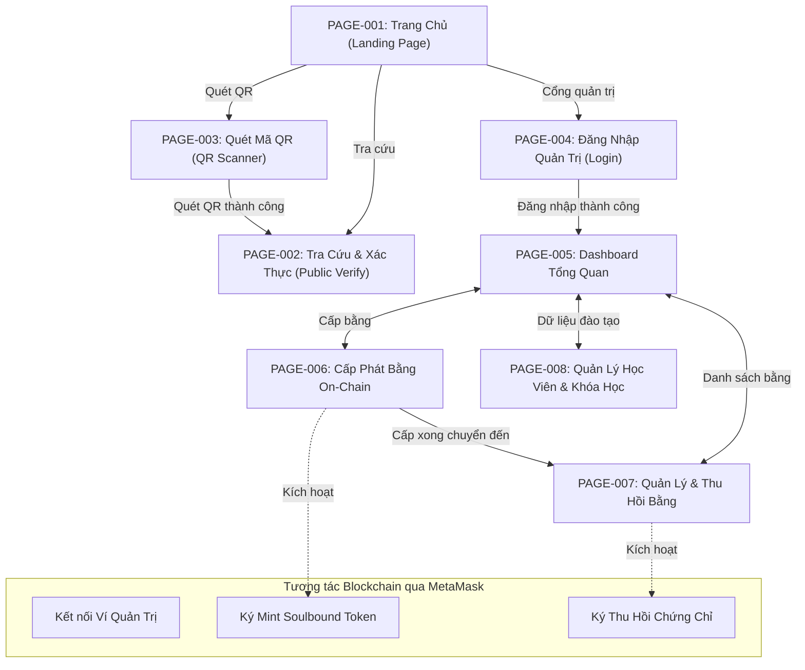

# TÀI LIỆU ĐẶC TẢ NGHIỆP VỤ (BA), THIẾT KẾ UI/UX & KIẾN TRÚC GIAO DIỆN HỆ THỐNG

> **Dự án**: Hệ Thống Quản Lý Chứng Chỉ Trung Tâm Tiếng Anh Bằng Blockchain *(English Center Certificate Management on Blockchain)*  
> **Đề tài môn học**: Blockchain & Ứng dụng  
> **Phiên bản**: v1.0.0 | **Ngày lập**: 29/10/2026  
> **Bộ phận phụ trách**: Frontend Engineer & Web3 UI (`dev-tv3`)  

---

## 📑 MỤC LỤC
1. [PHẦN 1: Tổng Quan Hệ Thống & Hiện Trạng](#phần-1-tổng-quan-hệ-thống--hiện-trạng)
2. [PHẦN 2: Danh Sách Tổng Thể Các Trang Giao Diện](#phần-2-danh-sách-tổng-thể-các-trang-giao-diện)
3. [PHẦN 3: Đặc Tả Chi Tiết Từng Trang Giao Diện](#phần-3-đặc-tả-chi-tiết-từng-trang-giao-diện)
   - [PAGE-001: Trang Chủ (Landing Page)](#1-page-001-trang-chủ-landing-page)
   - [PAGE-002: Tra Cứu & Xác Thực On-chain (Public Verification)](#2-page-002-tra-cứu--xác-thực-on-chain-public-verification)
   - [PAGE-003: Quét Mã QR Xác Thực (QR Scanner)](#3-page-003-quét-mã-qr-xác-thực-qr-scanner)
   - [PAGE-004: Đăng Nhập Quản Trị (Auth Login)](#4-page-004-đăng-nhập-quản-trị-auth-login)
   - [PAGE-005: Dashboard Tổng Quan (Admin Dashboard)](#5-page-005-dashboard-tổng-quan-admin-dashboard)
   - [PAGE-006: Cấp Phát Chứng Chỉ On-chain (Issue Certificate)](#6-page-006-cấp-phát-chứng-chỉ-on-chain-issue-certificate)
   - [PAGE-007: Danh Sách & Thu Hồi Chứng Chỉ (Certificates Management)](#7-page-007-danh-sách--thu-hồi-chứng-chỉ-certificates-management)
   - [PAGE-008: Quản Lý Học Viên & Khóa Học (Data Management)](#8-page-008-quản-lý-học-viên--khóa-học-data-management)
4. [PHẦN 4: Sơ Đồ Điều Hướng & Luồng Nghiệp Vụ](#phần-4-sơ-đồ-điều-hướng--luồng-nghiệp-vụ)
5. [PHẦN 5: Danh Sách Thành Phần Dùng Chung (Reusable Components)](#phần-5-danh-sách-thành-phần-dùng-chung-reusable-components)
6. [PHẦN 6: Đánh Giá Hiện Trạng, Khoảng Trống & Rủi Ro](#phần-6-đánh-giá-hiện-trạng-khoảng-trống--rủi-ro)
7. [PHẦN 7: Kế Hoạch Triển Khai Chi Tiết](#phần-7-kế-hoạch-triển-khai-chi-tiết)

---

## PHẦN 1: TỔNG QUAN HỆ THỐNG & HIỆN TRẠNG

### 1.1. Mục đích hệ thống
Hệ thống giải quyết triệt để vấn đề gian lận bằng cấp, làm giả chứng chỉ và sửa điểm thi tiếng Anh (IELTS, TOEIC, TOEFL, VSTEP) thông qua sự kết hợp của 2 công nghệ nền tảng:
* **Hợp đồng thông minh Soulbound Token (SBT)**: Chứng chỉ số gắn chặt với định danh người học, không thể chuyển nhượng hoặc buôn bán.
* **Lưu trữ phi tập trung IPFS (InterPlanetary File System)**: Lưu trữ phôi bằng PDF và metadata bất biến, vĩnh viễn, loại bỏ rủi ro mất dữ liệu tập trung.
* **Xác thực tức thì (Instant Verification)**: Bất kỳ nhà tuyển dụng nào cũng có thể kiểm tra trực tiếp tính hợp pháp của tấm bằng trên Blockchain trong vòng 1–2 giây thông qua mã QR hoặc mã chứng chỉ.

### 1.2. Các nhóm người dùng (Actors) & Phân quyền
Dựa trên cấu trúc cơ sở dữ liệu đã thiết kế (`backend/database/schema.sql`), hệ thống có 4 nhóm đối tượng:

| STT | Đối tượng | Role Code | Cơ chế xác thực | Quyền hạn nghiệp vụ |
| :---: | :--- | :---: | :--- | :--- |
| **1** | **Khách vãng lai / Nhà tuyển dụng** | `PUBLIC` | Không cần đăng nhập | Tra cứu on-chain, quét mã QR camera, tải file phôi bằng PDF hợp lệ. |
| **2** | **Học viên** | `STUDENT` | Tra cứu mã / Email / Đăng nhập | Xem chứng chỉ của bản thân, tải phôi bằng gốc, xem liên kết token trên blockchain. |
| **3** | **Cán bộ đào tạo / Nhân viên** | `STAFF` | JWT (Username/Password) | Quản lý học viên, khóa học, tạo bản nháp chứng chỉ (`CREATE_DRAFT`), xem nhật ký. |
| **4** | **Quản trị viên / Ban giám đốc** | `ADMIN` | JWT + **Ví MetaMask (Owner)** | Toàn quyền: Duyệt & ký giao dịch cấp bằng on-chain (`issueCertificate`), Thu hồi chứng chỉ (`revokeCertificate`). |

### 1.3. Đánh giá hiện trạng trong Repository Git
* **Trạng thái thực tế**:
  - `origin/main` đã có file `backend/database/schema.sql` xác định rõ 5 bảng: `users`, `students`, `courses`, `certificates`, `issue_logs`.
  - Thư mục `frontend/` hiện chỉ có file `README.md`, chưa có cấu trúc mã nguồn React/Vite.
  - Nhánh hiện tại `dev-tv3` sẵn sàng để triển khai mã nguồn giao diện mà không ảnh hưởng tới các thành viên khác.

---

## PHẦN 2: DANH SÁCH TỔNG THỂ CÁC TRANG GIAO DIỆN

Hệ thống được thiết kế tinh gọn gồm **8 trang độc lập**, kết hợp các Modal nghiệp vụ chuyên sâu:

| Mã trang | Tên trang | Nhóm chức năng | Người dùng | Mục đích chính | Trạng thái | Độ ưu tiên |
| :---: | :--- | :--- | :--- | :--- | :---: | :---: |
| **PAGE-001** | Trang Chủ (Landing Page) | Công khai | `PUBLIC`, Tất cả | Giới thiệu hệ sinh thái, thống kê nhanh, điều hướng chức năng | Chưa có | **Cao (P1)** |
| **PAGE-002** | Tra Cứu & Xác Thực On-chain | Tra cứu công khai | `PUBLIC`, Tất cả | Tra cứu mã chứng chỉ, đối soát dữ liệu Smart Contract & IPFS | Chưa có | **Cao (P1)** |
| **PAGE-003** | Quét Mã QR Xác Thực | Xác thực di động | `PUBLIC`, Tất cả | Quét mã QR bằng Camera hoặc tải ảnh để kiểm tra tức thì | Chưa có | **Cao (P1)** |
| **PAGE-004** | Đăng Nhập Hệ Thống | Xác thực tài khoản | Cán bộ / Admin | Đăng nhập tài khoản nội bộ (Username/Password) | Chưa có | **Trung bình (P2)** |
| **PAGE-005** | Dashboard Tổng Quan | Báo cáo & Thống kê | `ADMIN`, `STAFF` | Tổng quan số lượng bằng, biểu đồ khóa học, kiểm tra ví Web3 | Chưa có | **Trung bình (P2)** |
| **PAGE-006** | Cấp Phát Chứng Chỉ On-chain | Quản lý chứng chỉ | `ADMIN`, `STAFF` | Form nhập điểm, Live Preview phôi bằng, ký MetaMask đúc SBT | Chưa có | **Rất cao (P0)** |
| **PAGE-007** | Danh Sách & Thu Hồi Chứng Chỉ | Quản lý chứng chỉ | `ADMIN`, `STAFF` | Quản lý bảng chứng chỉ, lọc trạng thái, xuất PDF, ký Revoke | Chưa có | **Rất cao (P0)** |
| **PAGE-008** | Quản Lý Học Viên & Khóa Học | Quản trị dữ liệu | `ADMIN`, `STAFF` | Quản lý danh sách học sinh và danh mục kỳ thi tiếng Anh | Chưa có | **Thấp (P3)** |

---

## PHẦN 3: ĐẶC TẢ CHI TIẾT TỪNG TRANG GIAO DIỆN

---

### 1. PAGE-001: TRANG CHỦ (LANDING PAGE)

#### A. Thông tin chung
* **Mục đích**: Cung cấp bức tranh toàn cảnh về hệ thống chứng chỉ số, hiển thị độ tin cậy và là cửa ngõ dẫn đến chức năng Tra cứu công khai hoặc Cổng quản trị.
* **Đối tượng sử dụng**: Tất cả mọi người (Nhà tuyển dụng, học viên, giảng viên chấm điểm).
* **Quyền truy cập**: Public.
* **Đường dẫn (Route)**: `/`
* **Nguồn điều hướng**: Truy cập trực tiếp hoặc bấm vào Logo tại Navbar.

#### B. Bố cục giao diện
* **Header / Navbar**: Logo trung tâm tiếng Anh, Menu (`Trang chủ`, `Tra cứu`, `Quét QR`, `Cổng quản trị`), Nút kết nối ví `Connect Wallet`.
* **Hero Banner**: Tiêu đề lớn (Headline) nổi bật sứ mệnh chống làm giả chứng chỉ, mô tả ngắn công nghệ Soulbound Token & IPFS, 2 nút CTA (Call to Action).
* **Khối số liệu thống kê (Stats Counter Grid)**: 4 thẻ chỉ số: Tổng chứng chỉ đã cấp, Khóa học hỗ trợ, Giao dịch on-chain, Tỷ lệ xác thực thành công.
* **Khối tính năng cốt lõi (Features Showcase)**: 3 card giới thiệu (Chống giả mạo 100%, Soulbound Token cấm chuyển nhượng, Thẩm định tức thì bằng QR).
* **Quy trình hoạt động (Workflow Timeline)**: 4 bước trực quan: *Thi đạt -> Trung tâm ký duyệt -> Đúc SBT & đẩy IPFS -> Xác thực công khai*.
* **Footer**: Thông tin liên hệ trung tâm, địa chỉ Smart Contract, link GitHub repo, link Etherscan/Polygonscan explorer.

#### C. Danh sách thành phần & Chức năng
1. **Hero CTA Buttons**:
   - Nút `Tra cứu chứng chỉ`: Nhấp chuyển sang `PAGE-002`.
   - Nút `Cổng quản trị`: Nếu chưa đăng nhập chuyển `PAGE-004`; nếu đã đăng nhập chuyển `PAGE-005`.
2. **Stats Counter**:
   - Dữ liệu hiển thị: Gọi API `/api/stats/overview` (hoặc hiển thị số liệu thực tế từ contract).
3. **Smart Contract Badge**:
   - Hiển thị địa chỉ rút gọn của Contract trên mạng Testnet (VD: `0x71C...89E2`) kèm biểu tượng chấm xanh Online. Bấm vào mở trình khám phá khối (Block Explorer).

---

### 2. PAGE-002: TRA CỨU & XÁC THỰC ON-CHAIN (PUBLIC VERIFICATION)

#### A. Thông tin chung
* **Mục đích**: Cho phép bất kỳ ai kiểm tra chứng chỉ thật hay giả trực tiếp từ Blockchain.
* **Đối tượng**: Mọi đối tượng (Public).
* **Quyền truy cập**: Public.
* **Đường dẫn (Route)**: `/verify` hoặc `/verify?code={certificate_code}`
* **Nguồn điều hướng**: Menu "Tra cứu", kết quả quét QR từ `PAGE-003`, hoặc quét URL trực tiếp.

#### B. Bố cục giao diện
* **Thanh tìm kiếm trung tâm (Search Bar)**: Ô input lớn kèm nút "Tra cứu" và nút "Mở camera quét QR".
* **Khu vực kết quả xác thực (Verification Result Banner)**:
  - Badge trạng thái kích thước lớn:  
    ✅ **CHỨNG CHỈ HỢP LỆ (ON-CHAIN VERIFIED)** (Màu xanh lục)  
    ❌ **CHỨNG CHỈ ĐÃ BỊ THU HỒI (REVOKED)** (Màu đỏ)  
    ⚠️ **KHÔNG TÌM THẤY CHỨNG CHỈ NÀY** (Màu cam)
* **Khung chi tiết chứng chỉ (Certificate Details Card)**:
  - Cột trái (Thông tin học thuật): Họ tên học viên, Mã sinh viên, Khóa học (IELTS/TOEIC/VSTEP), Điểm Overall và điểm thành phần, Ngày cấp, Thời hạn.
  - Cột phải (Dữ liệu Blockchain): Token ID, Transaction Hash, Địa chỉ ví học viên, IPFS Hash CID.
* **Khu vực thao tác (Action Bar)**:
  - Nút **"Tải phôi bằng PDF"** (`Download PDF`).
  - Nút **"Xem file gốc trên IPFS"** (Mở tab IPFS Gateway).
  - Nút **"Kiểm tra trên Block Explorer"** (Mở Etherscan/Polygonscan theo `tx_hash`).

#### C. Quy trình xử lý đối soát (Verification Engine)
```
[Nhập mã bằng hoặc Quét QR]
            │
            ▼
[Frontend gọi đồng thời Contract RPC & Backend API]
            │
   ┌────────┴────────┐
   ▼                 ▼
[Contract: Hợp lệ?] [Backend: Có dữ liệu?]
   │                 │
   └────────┬────────┘
            │
 ┌──────────┼──────────┐
 ▼          ▼          ▼
[HỢP LỆ] [BỊ THU HỒI] [KHÔNG TỒN TẠI]
 (Xanh)     (Đỏ)        (Cam)
```

---

### 3. PAGE-003: QUÉT MÃ QR XÁC THỰC (QR SCANNER)

#### A. Thông tin chung
* **Mục đích**: Cho phép quét mã QR in trên phôi bằng giấy hoặc trên màn hình khác bằng camera thiết bị để xác thực siêu nhanh trong 1 giây.
* **Đối tượng**: Mọi đối tượng.
* **Quyền truy cập**: Public.
* **Đường dẫn (Route)**: `/scanner`
* **Nguồn điều hướng**: Nút "Quét QR" trên Header hoặc nút trên trang chủ `PAGE-001`.

#### B. Bố cục giao diện
* **Khung kính ngắm Camera (Camera Viewport)**: Khung quét hình vuông trung tâm có hiệu ứng quét tia laser chuyển động (Laser scanning animation).
* **Nút điều khiển Camera**: Nút bật/tắt camera, nút chuyển đổi camera trước/sau (đối với điện thoại di động).
* **Khu vực Tải ảnh QR (Upload Fallback)**: Khu vực kéo thả hoặc bấm tải ảnh chụp mã QR từ máy tính/điện thoại.
* **Chỉ dẫn người dùng**: Dòng text hướng dẫn đặt mã QR vào chính giữa khung ngắm.

#### C. Chức năng
* Sử dụng thư viện `html5-qrcode` giải mã luồng video thời gian thực.
* Tự động trích xuất mã chứng chỉ từ URL QR và chuyển hướng tức thì sang `PAGE-002?code=...`.

---

### 4. PAGE-004: ĐĂNG NHẬP HỆ THỐNG QUẢN TRỊ (AUTH LOGIN)

#### A. Thông tin chung
* **Mục đích**: Xác thực định danh cán bộ trung tâm (`ADMIN`, `STAFF`) để truy cập các tính năng quản lý nội bộ.
* **Đối tượng**: Cán bộ đào tạo, Quản trị viên.
* **Quyền truy cập**: Khách chưa đăng nhập.
* **Đường dẫn (Route)**: `/login`
* **Nguồn điều hướng**: Nút "Cổng quản trị" tại Header.

#### B. Bố cục giao diện
* Form đăng nhập trung tâm phong cách Glassmorphism:
  - Trường `Tên đăng nhập` (Username).
  - Trường `Mật khẩu` (Password) có nút ẩn/hiện mật khẩu.
  - Checkbox `Ghi nhớ đăng nhập`.
  - Nút `Đăng nhập`.
  - Ghi chú: "Để thực hiện cấp bằng on-chain hoặc thu hồi, bạn cần kết nối thêm ví MetaMask của quản trị viên sau khi đăng nhập".

---

### 5. PAGE-005: DASHBOARD TỔNG QUAN (ADMIN DASHBOARD)

#### A. Thông tin chung
* **Mục đích**: Cung cấp bức tranh toàn cảnh về hoạt động cấp phát chứng chỉ, tình trạng kết nối ví Web3 và các cảnh báo hệ thống.
* **Đối tượng**: `ADMIN`, `STAFF`.
* **Quyền truy cập**: Bắt buộc đăng nhập.
* **Đường dẫn (Route)**: `/admin/dashboard`
* **Nguồn điều hướng**: Sau khi đăng nhập thành công từ `PAGE-004`.

#### B. Bố cục giao diện
* **Thanh cảnh báo Web3 (Web3 Status Banner)**:
  - Kiểm tra trạng thái MetaMask và mạng Testnet (Localhost/Amoy/Sepolia). Nếu chưa kết nối sẽ hiển thị nút "Kết nối ví Admin".
* **Hàng thẻ số liệu (Metrics Grid)**:
  - Tổng số chứng chỉ đã cấp (`ISSUED_ON_CHAIN`).
  - Số chứng chỉ đang chờ đúc (`PENDING`).
  - Số chứng chỉ bị thu hồi (`REVOKED`).
  - Tổng số học viên và khóa học.
* **Bảng thao tác nhanh (Quick Action Center)**: Nút tắt dẫn thẳng đến Form cấp bằng hoặc Quản lý học viên.
* **Biểu đồ phân bố (Charts)**: Biểu đồ tròn tỷ lệ khóa học (IELTS, TOEIC, VSTEP) và biểu đồ cột chứng chỉ theo tháng.
* **Nhật ký thao tác gần đây (Recent Logs)**: Hiển thị 5 thao tác mới nhất từ bảng `issue_logs`.

---

### 6. PAGE-006: CẤP PHÁT CHỨNG CHỈ ON-CHAIN (ISSUE CERTIFICATE)

#### A. Thông tin chung
* **Mục đích**: Nhập thông tin chứng chỉ của học viên, sinh phôi bằng PDF nhúng QR, đẩy IPFS và gửi giao dịch đúc Soulbound Token lên Blockchain.
* **Đối tượng**: `ADMIN` (Ký on-chain), `STAFF` (Tạo bản nháp `PENDING`).
* **Quyền truy cập**: Bắt buộc đăng nhập.
* **Đường dẫn (Route)**: `/admin/certificates/issue`

#### B. Bố cục giao diện (Thiết kế chia đôi 2 cột - Split Screen)
* **Cột trái (Form nhập liệu)**:
  - Chọn học viên (Dropdown có tìm kiếm theo tên hoặc mã sinh viên).
  - Chọn khóa học/kỳ thi (IELTS, TOEIC, TOEFL, VSTEP).
  - Nhập điểm thi: Trường điểm Overall và các điểm thành phần (Listening, Reading, Writing, Speaking).
  - Chọn ngày cấp thi (`issue_date`) và ngày hết hạn (`expiry_date`).
  - Địa chỉ ví nhận của học viên (`wallet_address`).
* **Cột phải (Live Certificate Preview)**:
  - Khung xem trước mẫu phôi bằng thời gian thực (Live Preview).
  - Khi người dùng gõ tên hoặc điểm bên trái, bản in bên phải tự động cập nhật ngay lập tức.
  - Khu vực hiển thị mã QR mẫu.
* **Thanh nút bấm hành động (Action Bar)**:
  - Nút `Lưu bản nháp (Draft)`: Lưu trạng thái `PENDING` vào CSDL.
  - Nút `Ký & Phát hành On-Chain (Issue & Mint SBT)`: Kích hoạt MetaMask gửi transaction gọi hàm `issueCertificate`.

---

### 7. PAGE-007: DANH SÁCH & THU HỒI CHỨNG CHỈ (CERTIFICATES MANAGEMENT)

#### A. Thông tin chung
* **Mục đích**: Quản lý toàn bộ kho chứng chỉ đã phát hành, tìm kiếm, lọc trạng thái, xem phôi bằng PDF và thực hiện thu hồi khi có gian lận.
* **Đối tượng**: `ADMIN`, `STAFF`.
* **Quyền truy cập**: Bắt buộc đăng nhập.
* **Đường dẫn (Route)**: `/admin/certificates`

#### B. Bố cục giao diện
* **Thanh công cụ lọc (Filter Toolbar)**: Ô tìm kiếm, Dropdown lọc Khóa học, Dropdown lọc Trạng thái (`PENDING`, `ISSUED_ON_CHAIN`, `REVOKED`), Bộ chọn ngày.
* **Bảng dữ liệu (Data Table)**:
  - Cột: Mã bằng, Tên học viên & MSSV, Khóa học & Điểm, Ngày cấp, Trạng thái (Badge màu), Bằng chứng On-chain (Link IPFS & TxHash), Cột Thao tác.
* **Modal Xem trước PDF (PDF Viewer Modal)**: Hiển thị file PDF chứng chỉ để in hoặc tải về.
* **Modal Xác nhận Thu hồi (Revoke Modal)**:
  - Cảnh báo trạng thái thu hồi là vĩnh viễn trên Blockchain.
  - Ô nhập lý do thu hồi (Bắt buộc).
  - Nút `Ký giao dịch thu hồi trên MetaMask` (gọi hàm `revokeCertificate`).

---

### 8. PAGE-008: QUẢN LÝ HỌC VIÊN & KHÓA HỌC (DATA MANAGEMENT)

#### A. Thông tin chung
* **Mục đích**: Quản lý dữ liệu nền tảng phục vụ việc cấp bằng: Hồ sơ học viên (Họ tên, ngày sinh, ví MetaMask) và Danh mục kỳ thi (Mã khóa học, thời lượng, mô tả).
* **Đối tượng**: `ADMIN`, `STAFF`.
* **Quyền truy cập**: Bắt buộc đăng nhập.
* **Đường dẫn (Route)**: `/admin/data-management` (Gồm 2 Tab: `Học viên` và `Khóa học`).

---

## PHẦN 4: SƠ ĐỒ ĐIỀU HƯỚNG & LUỒNG NGHIỆP VỤ



---

## PHẦN 5: DANH SÁCH THÀNH PHẦN DÙNG CHUNG (REUSABLE COMPONENTS)

| Tên Component | Vị trí sử dụng | Chức năng chi tiết |
| :--- | :--- | :--- |
| **`Navbar`** | Toàn bộ trang | Thanh điều hướng đầu trang, tích hợp nút kết nối MetaMask, hiển thị mạng và avatar người dùng. |
| **`WalletConnector`** | Navbar, Dashboard | Quản lý kết nối ví, kiểm tra địa chỉ ví và cảnh báo chuyển đúng mạng Blockchain. |
| **`CertificateCard`** | `PAGE-002`, `PAGE-006` | Khung hiển thị mô phỏng phôi chứng chỉ tiếng Anh (Viền hoa văn cổ điển, logo trung tâm, chữ ký số, mã QR). |
| **`StatusBadge`** | `PAGE-002`, `PAGE-005`, `PAGE-007` | Hiển thị nhãn trạng thái trực quan: Xanh lá (`ISSUED_ON_CHAIN`), Đỏ (`REVOKED`), Vàng (`PENDING`). |
| **`DataTable`** | `PAGE-007`, `PAGE-008` | Bảng hiển thị dữ liệu chuẩn: Tìm kiếm, phân trang, lọc cột, loading skeleton. |
| **`ConfirmModal`** | `PAGE-007`, `PAGE-008` | Popup xác nhận thao tác quan trọng (Thu hồi bằng, xóa dữ liệu). |
| **`TxHashLink`** | `PAGE-002`, `PAGE-005`, `PAGE-007` | Hiển thị mã Hash giao dịch rút gọn, bấm vào tự mở đúng trình duyệt khối Etherscan/Polygonscan. |

---

## PHẦN 6: ĐÁNH GIÁ HIỆN TRẠNG, KHOẢNG TRỐNG & RỦI RO

1. **Frontend (`dev-tv3` - Vai trò của bạn)**:
   - Cần khởi tạo cấu trúc dự án React Vite trong thư mục `frontend/`.
   - Cần cài đặt các thư viện: `ethers` (Web3), `html5-qrcode` (quét camera), `lucide-react` (icon), `react-router-dom` (điều hướng).
2. **Backend (`dev-tv2`)**:
   - Đã có `schema.sql` xác định cấu trúc CSDL nhưng chưa dựng server Express API. Frontend sẽ cấu hình sẵn Mock API để phát triển độc lập trong lúc chờ backend hoàn thiện.
3. **Smart Contract (`dev-tv1`)**:
   - Cần sớm có ABI và địa chỉ Smart Contract để frontend kết nối gọi hàm.

---

## PHẦN 7: KẾ HOẠCH TRIỂN KHAI CHI TIẾT

* **Giai đoạn 1**: Khởi tạo dự án Vite React trong thư mục `frontend/`, cấu hình Design System, dựng Navbar & kết nối ví MetaMask.
* **Giai đoạn 2**: Xây dựng các trang công khai phục vụ chấm điểm: `PAGE-001` (Trang chủ), `PAGE-002` (Tra cứu On-chain), `PAGE-003` (Quét QR Camera).
* **Giai đoạn 3**: Xây dựng phân hệ Quản trị: `PAGE-004` (Đăng nhập), `PAGE-005` (Dashboard), `PAGE-006` (Cấp bằng on-chain), `PAGE-007` (Quản lý & Thu hồi).
* **Giai đoạn 4**: Tích hợp tổng thể với Smart Contract thật của TV1 và API của TV2, kiểm thử tương tác ví và tối ưu responsive trên di động.
